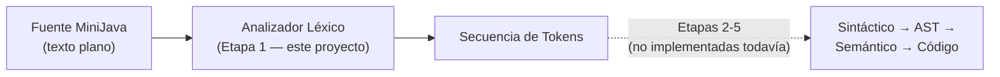
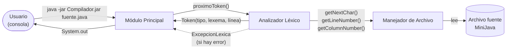
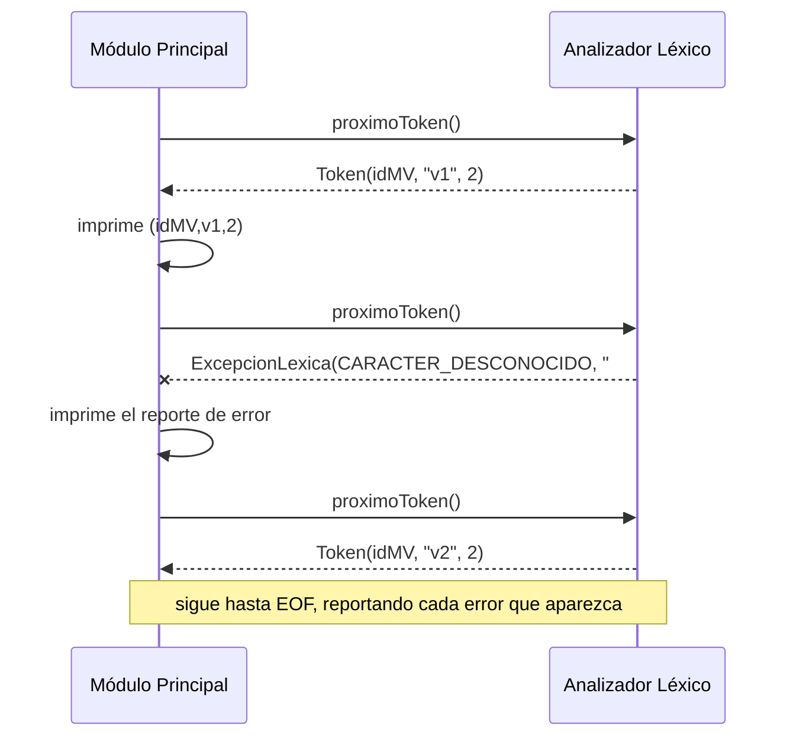
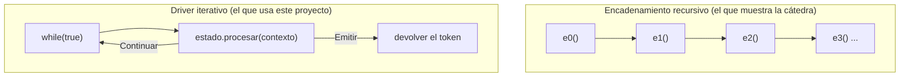

# Arquitectura del Compilador MiniJava — Etapa 1

Documento autocontenido: alcanza para entender qué hace el proyecto, cómo están armadas sus piezas y
cómo interactúan, **sin leer una sola línea de código**. Es el punto de entrada de la carpeta; el
resto de los documentos profundiza cada área.

## 1. Qué es este proyecto y qué problema resuelve

Es la **Etapa 1** de un compilador para **MiniJava** — un subconjunto estricto de Java, sin
excepciones y sin hilos — para la materia *Compiladores e Intérpretes* de la UNS. El compilador
completo se construye a lo largo de 5 etapas; esta etapa construye únicamente el **Analizador
Léxico**, la primera fase de todo compilador.

Un analizador léxico convierte una secuencia de **caracteres** (el texto plano del programa) en una
secuencia de **tokens**: las unidades mínimas con significado propio del lenguaje. Donde el archivo
dice `v1+543`, el analizador ve tres cosas — un identificador, un operador de suma y un literal
entero — y no siete caracteres sueltos.



Por qué esta fase existe como fase separada: las etapas siguientes razonan sobre estructuras
gramaticales (`una declaración`, `una expresión`), y esas reglas serían inmanejables si además
tuvieran que preocuparse por espacios, comentarios y por dónde termina un número. El léxico absorbe
toda esa complejidad de bajo nivel y entrega un flujo limpio y uniforme.

## 2. Los tres componentes

La cátedra fija un esquema de tres piezas. Dos las construye este proyecto; la tercera
(`SourceManager`, el acceso de bajo nivel al archivo) la provee la cátedra como interfaz, y este
proyecto la implementa de nuevo — ver [`manejador-de-archivo.md`](manejador-de-archivo.md) y §7.



**Módulo Principal** — `minijava.aplicacion.Main` + `ModuloPrincipal`. Es la interfaz con el usuario y
el **cliente** del analizador. Recibe la ruta del archivo por línea de comandos, abre el manejador,
y entra en un bucle pidiendo tokens de a uno hasta recibir el token `EOF`. Imprime cada token que
recibe y, al final, `[SinErrores]` o los reportes de error. Es también quien decide **qué hacer ante
un error**: la cátedra especifica "reportar y finalizar", y el logro *Multi-detección de Errores*
cambia esa política a "reportar y seguir" — la política vive acá, no dentro del analizador.

**Analizador Léxico** — `minijava.lexico.AnalizadorLexico`. Reconoce **un** token cada vez que se lo
invoca (`proximoToken()`), leyendo del manejador exactamente los caracteres que necesita y ni uno
más. No conoce a `System.out`, no decide políticas de error, no sabe qué hará el cliente con el
token. Su implementación interna es el patrón State — §4 y [`patron-state.md`](patron-state.md).

**Manejador de Archivo** — `minijava.io.ManejadorDeArchivoEficiente`. Abstrae el acceso al archivo:
entrega un carácter por vez, lleva la cuenta de línea y columna, y sabe devolver el texto completo de
la línea en curso (que el reporte de error necesita para dibujar el `^`).

### Por qué esta división y no otra

Cada pieza tiene **una** razón para cambiar, que es el criterio de responsabilidad única:

- si cambia el formato de salida (otra convención de impresión), cambia sólo el Módulo Principal;
- si cambia el lenguaje (un token nuevo), cambia sólo el Analizador Léxico;
- si cambia el origen del texto (un archivo comprimido, un editor en memoria), cambia sólo el
  Manejador de Archivo.

Ninguna de esas tres cosas obliga a tocar las otras dos. Concretamente: los 8 logros de la Etapa 1
se implementaron sin que ninguna pieza tuviera que aprender algo de otra.

## 3. El ciclo de vida de una ejecución

Fuente de ejemplo, tomado literal de la consigna:

```java
"hola"
v1 + chau
if class}
```

1. El usuario ejecuta `java -jar Compilador.jar programa.java`.
2. `Main` valida que haya un argumento y delega en `ModuloPrincipal.ejecutar(ruta)`.
3. `ModuloPrincipal` abre el archivo con el Manejador y crea un `AnalizadorLexico`.
4. Bucle: pide un token y lo imprime.
   Repite hasta `EOF`.
5. Sin errores, imprime `[SinErrores]`. El manejador se cierra en un `finally`.

```text
(litString,"hola",1)
(idMV,v1,2)
(op+,+,2)
(idMV,chau,2)
(pr_if,if,3)
(pr_class,class,3)
(llaveC,},3)
(EOF,$,3)
[SinErrores]
```

Con un error léxico, el analizador **lanza** `ExcepcionLexica` en vez de devolver un token. El Módulo
Principal la captura, imprime el reporte y vuelve a pedir el token siguiente:



Salida real de ese fuente (`class A1 {` / `v1 # v2` / `}`):

```text
(pr_class,class,1)
(idClase,A1,1)
(llaveA,{,1)
(idMV,v1,2)
Error Léxico en línea 2, columna 4: # no es un símbolo válido
Detalle: v1 # v2
            ^
[Error:#|2]
(idMV,v2,2)
(llaveC,},3)
(EOF,$,4)
```

**No hay un paso de recuperación.** Es una propiedad importante y contraintuitiva: el Módulo
Principal no llama a ningún `recuperarDeError()`, simplemente vuelve a pedir un token. Funciona
porque el analizador garantiza que **todo estado que lanza un error consumió del fuente exactamente
los caracteres que reportó en el lexema, ni uno más** — así el siguiente `proximoToken()` arranca
naturalmente en el primer carácter que no formó parte del error. El detalle, y el defecto que esto
arregló, están en [`manejo-de-errores.md`](manejo-de-errores.md) §2.

La única excepción es un escape mal formado dentro de un `litString`: ahí sí se descarta lo que queda
del literal hasta su comilla de cierre, para que el análisis se reanude fuera del literal y no en
mitad de su contenido. Es resincronización en modo pánico, y se explica entera en
[`manejo-de-errores.md`](manejo-de-errores.md) §2.1.

## 4. Cómo reconoce un token: Método por Estado

### 4.1. La técnica es obligatoria, no una elección

La cátedra presenta tres estrategias de implementación (Método por Estado, Switch/Case, Tabla de
transiciones) y fija la primera. **Método por Estado** significa: por cada estado del Autómata Finito
que reconoce el lenguaje, se construye un componente de software que simula el comportamiento del
autómata estando en ese estado.

Se implementó como el patrón de diseño **State** (Gang of Four), que es la forma orientada a objetos
canónica de esa técnica: cada estado es una clase con un único método, `procesar(contexto)`, que
mira el carácter actual y decide qué hacer y a qué estado ir.

Está **prohibido** usar generadores automáticos (JFlex, ANTLR, lex/flex): el autómata se escribe a
mano, que es justamente el ejercicio.

### 4.2. La única libertad que se tomó: driver iterativo en vez de recursión

La cátedra encadena los estados con llamadas recursivas: el estado `e1()` termina con `return e2()`,
que termina con `return e3()`, etc. Este proyecto usa la misma técnica —un componente por estado—
pero con un **driver central** que hace un bucle, en vez de que los estados se llamen entre sí.



**Por qué**: con el encadenamiento recursivo, cada carácter del lexema apila un marco de pila de la
JVM. Un comentario de diez mil caracteres apila diez mil llamadas y puede agotar la pila con
`StackOverflowError` — un fallo que no es un error léxico sino una caída del compilador. El driver
iterativo reconoce lexemas de cualquier longitud con **una sola** llamada activa por vez, y conserva
exactamente la estructura de "un componente por estado" que exige la técnica.

Es la única desviación respecto de lo que muestran las slides, y es deliberada.

### 4.3. Las piezas del driver

| Pieza | Rol |
|---|---|
| `EstadoLexico` | La interfaz común: un único método `procesar(contexto)`. |
| `ContextoLexico` | Lo que todos los estados comparten, como fachada de dos piezas: `BuilderDeLexema` (el carácter que se está mirando, el lexema que se viene armando y las posiciones que los errores necesitan) y `FabricaDeExcepcionesLexicas` (el punto único donde se construye una `ExcepcionLexica`). Expone `avanzar()` (consumir el carácter y agregarlo al lexema) y `descartar()` (consumirlo sin agregarlo — blancos, comentarios y la resincronización de un `litString` roto). |
| `ResultadoDeTransicion` | Lo que devuelve `procesar()`. Es una `sealed interface` con exactamente dos implementaciones posibles. |
| `Continuar(siguiente)` | "Todavía no hay token: seguí desde este otro estado." |
| `Emitir(token)` | "El token está completo: acá está." |
| `AnalizadorLexico.proximoToken()` | El driver: arranca en `EstadoInicial` y repite hasta que alguien responda `Emitir`. |

### 4.4. Ejemplo trazado: reconocer `>=`

Fuente `>=543`. La cátedra usa este mismo ejemplo para explicar por qué hace falta mirar un carácter
por adelantado (*lookahead*) antes de decidir entre `>` y `>=`:

| Paso | Estado | Mira | Acción | Devuelve |
|---|---|---|---|---|
| 1 | `EstadoInicial` | `>` | `>` puede empezar un operador con sufijo opcional; lo consume | `Continuar(EstadoOperadorConSufijoOpcional.MAYOR)` |
| 2 | `EstadoOperadorConSufijoOpcional.MAYOR` | `=` | el sufijo está: lo consume | `Emitir(Token(op_mayorIgual, ">=", 1))` |

Si en el paso 2 viniera `5` en vez de `=`, el mismo estado emitiría `Token(op_mayor, ">", 1)` **sin
consumir** el `5`, que queda disponible para el próximo `proximoToken()`. Este es el principio de
**maximal munch**: se arma el lexema más largo posible y recién cuando ya no se puede extender se
emite el token. Es también la razón por la que `1abc` produce dos tokens (`intLiteral(1)` +
`idMV(abc)`) en vez de un error.

El trazado completo de un caso largo (`1.5e-3f`, siete estados) está en
[`patron-state.md`](patron-state.md) §4.

## 5. Decisiones estructurales y por qué se tomaron

### 5.1. `Salida` es una interfaz, no `System.out` esparcido

Toda la salida pasa por `minijava.salida.Salida`. `SalidaEstandar` —la única implementación que usa
`Main`— delega en `System.out`, así que hacia afuera el comportamiento es exactamente el que exige la
cátedra ("toda la salida por `System.out`").

**Por qué la indirección**: es la decisión de mayor impacto en la testeabilidad del proyecto. Permite
ejercitar el Módulo Principal completo contra una `SalidaEnMemoria` que guarda las líneas en una
lista, y compararlas con `assertEquals` una por una. Sin esto habría que capturar y restaurar el
stream global de la JVM en cada test — una alternativa más frágil para la ejecución en paralelo.

### 5.2. Todas las dependencias se inyectan por constructor

`ModuloPrincipal` recibe su `Salida` y su configuración; `AnalizadorLexico` recibe su
`ContextoLexico` ya construido, y el `ModuloPrincipal` es quien lo arma con la configuración que a su
vez recibió. Ninguna clase busca sus colaboradores en una variable global. Consecuencia práctica:
cada pieza se testea sustituyendo colaboradores reales, sin necesidad de un framework de mocking.

Que la cadena esté completa no es cosmético. Mientras `AnalizadorLexico` construía su propio
`ContextoLexico` con la configuración por omisión, la configuración que `ModuloPrincipal` recibía de
su llamador **se perdía en el camino**: los dos flags que lee el autómata (*Floats I* y *Unicodes*)
no tenían efecto alguno al ejecutar el compilador de punta a punta. Los tests de configuración que
existían no lo detectaban porque ejercitaban los otros dos flags, que se resuelven fuera del léxico.
Hoy hay dos casos que recorren la cadena entera, uno por flag.

### 5.2.1. `ContextoLexico` es una fachada, no un objeto que hace de todo

Lo que los estados ven es una sola interfaz, pero detrás hay dos piezas con responsabilidades
separadas:

| Pieza | De qué se ocupa |
|---|---|
| `BuilderDeLexema` | El lexema en construcción, el carácter que se está mirando y las dos fotos de posición. Todo lo que cambia al consumir un carácter — más resolver un `AnclaDeError` a la `PosicionLexica` concreta, que es lo que él y sólo él puede hacer. |
| `FabricaDeExcepcionesLexicas` | El punto único de construcción de una `ExcepcionLexica`: recibe el tipo y un `AnclaDeError` que dice dónde cae el `^`, y arma los campos consistentes entre sí. |
| `EscapadorDeNoImprimibles` | Escapar los caracteres invisibles del lexema que se va a imprimir. Vive en `errores/`, aparte: es otra responsabilidad y se testea sola. |

La división no es teórica: son los motivos por los que la clase cambiaba. Un ajuste en cómo se cuenta
una línea y un ajuste en dónde apunta el `^` no tienen nada que ver entre sí, y antes convivían en el
mismo archivo junto con la lógica de escapado — que hoy tampoco está ahí. Los estados no se enteraron del cambio: la
fachada conserva exactamente la misma API que usaban.

### 5.3. Los cuatro logros de comportamiento se activan por configuración

`ConfiguracionDelCompilador(floatsHabilitados, unicodeHabilitado, reporteElegante,
multiDeteccionDeErrores)` — los cuatro en `true` por defecto.

**Por qué existe**: cada uno de esos cuatro logros *cambia el comportamiento observable* del
compilador. Sin un interruptor, el comportamiento base que pide la consigna (reportar el primer error
y terminar; no reconocer floats) quedaría sepultado, y sería imposible demostrar que también se
cumple. Con la configuración, cada combinación es testeable por separado, y se puede mostrar que el
compilador satisface **tanto** la consigna base **como** los logros.

Dos de los flags (`floatsHabilitados`, `unicodeHabilitado`) los consultan los estados del autómata,
porque cambian el lenguaje reconocido. Los otros dos viven fuera del léxico: `reporteElegante` lo usa
el formateador de errores, y `multiDeteccionDeErrores` el Módulo Principal.

### 5.4. Sin `System.exit()` y sin estado estático mutable

**Invariante dura, y no es estilística.** Los dos testers de la cátedra invocan `Main.main()`
**in-process y repetidamente** —una vez por caso parametrizado, en la misma JVM—. Un `System.exit()`
mataría la corrida completa de tests en la primera invocación, y cualquier estado estático mutable
haría que un caso contamine al siguiente. Por eso `Main`, ante un argumento faltante, imprime el uso
y retorna, en vez de terminar el proceso con un código de salida.

### 5.5. Reuso deliberado para no explotar en clases

Dos casos donde una clase por símbolo habría sido innecesaria:

- Los seis pares `>`/`>=`, `<`/`<=`, `!`/`!=`, `=`/`==`, `+`/`++`, `-`/`--` los cubre **un** estado
  parametrizado, `EstadoOperadorConSufijoOpcional`, con seis constantes configuradas.
- Los diez símbolos de puntuación de un carácter se resuelven con una tabla
  `Map<Character, TipoDeToken>` en el estado inicial, sin ninguna clase propia.

La regla general del proyecto es **modularidad por responsabilidad, no por cantidad de líneas**: no
hay un límite numérico de líneas por archivo; hay una regla de que cada clase tenga una
responsabilidad clara y acotada — un estado del autómata, un formateador, una excepción.

### 5.6. Las palabras clave no tienen autómata propio

Las 21 palabras reservadas se reconocen como un identificador común y, antes de emitir el token, se
consulta una tabla de lookup (`TablaDeLexemas`, que además nombra a los otros 28 tokens de lexema
fijo — ver [`especificacion-lexica.md`](especificacion-lexica.md) §7). Modelarlas con estados
dedicados exigiría casi
un estado por letra de cada palabra, fusionados con los estados de identificador — decenas de estados
frágiles para una decisión que una tabla resuelve en tiempo constante. Es la técnica estándar, y la
que la cátedra recomienda explícitamente (Clase 02, slides 62-63).

## 6. Estructura de paquetes

```
compilador/
├── pom.xml                       ← Maven: JUnit 5 (+vintage), jqwik, JaCoCo, PIT
├── resources/
│   ├── sinErrores/               ← 76 casos válidos, con oráculo //#lexema,línea
│   ├── conErrores/               ← 82 casos con error, con oráculo // [Error:lexema|línea]
│   └── regresion/                ← casos que reprodujeron un defecto real (nunca se borran)
└── src/
    ├── main/java/minijava/
    │   ├── aplicacion/           ← Main, ModuloPrincipal
    │   ├── config/               ← ConfiguracionDelCompilador
    │   ├── io/                   ← SourceManager + SourceManagerImpl (ORIGINALES de la cátedra,
    │   │                            contenido intacto), ManejadorDeArchivo + el reemplazo propio
    │   ├── tokens/               ← Token (record inmutable), TipoDeToken (56 valores),
    │   │                            TablaDeLexemas (los 49 tokens de lexema fijo)
    │   ├── errores/              ← ExcepcionLexica, TipoDeErrorLexico, FormateadorDeError,
    │   │                            PosicionLexica, EscapadorDeNoImprimibles
    │   ├── salida/               ← interfaz Salida + SalidaEstandar
    │   └── lexico/               ← AnalizadorLexico (el driver)
    │       ├── automata/         ← EstadoLexico, ResultadoDeTransicion, Continuar, Emitir
    │       ├── contexto/         ← ContextoLexico (fachada de BuilderDeLexema y
    │       │                        FabricaDeExcepcionesLexicas), AnclaDeError
    │       ├── recuperacion/     ← RecuperacionDeLitString
    │       └── estados/          ← EstadoInicial y un archivo por estado del AF, agrupados
    │                                en comentarios/ identificadores/ literales/ numeros/
    │                                operadores/
    └── test/java/
        ├── catedra/              ← los 2 testers de la cátedra (sólo se cambió el paquete y el
        │                            import de Main, cambio que la guía de uso autoriza)
        └── minijava/             ← suite propia, espejando la estructura de producción
```

Las clases `SourceManager` y `SourceManagerImpl` conservan su **contenido original** de la cátedra:
lo único que se les cambió es la declaración de `package`, para agruparlas con la interfaz y la
implementación propias que las extienden. No se reescribieron ni se corrigieron — el reemplazo es
una clase nueva y aparte, y las originales quedan como referencia de lo que se recibió.

## 7. El Manejador de Archivos Eficiente

Resumen; el desarrollo completo está en [`manejador-de-archivo.md`](manejador-de-archivo.md).

`ManejadorDeArchivoEficiente` implementa el logro homónimo: sirve el fuente **carácter por carácter**
en vez de línea por línea, con una única lectura del archivo en `open()`. Además de eso resuelve tres
requisitos que el resto del compilador da por sentados:

- **La línea del EOF** es `cantidad de saltos consumidos + 1`, incluido el caso del archivo que
  termina en salto de línea — es lo que esperan los oráculos de los tres casos de ejemplo.
- **El fin de archivo es una conjunción**: que llegue el centinela `(char) 26` **y** que la posición
  de lectura confirme que se acabó el contenido. Sólo la primera no alcanza, porque ese byte es
  legítimo dentro de un fuente; si llega sin la segunda, es un símbolo inválido.
- **La posición del error se obtiene sin una segunda pasada**: la columna es un contador O(1) y el
  texto de la línea se recorre sólo desde su inicio, nunca desde el principio del archivo.

## 8. Ver también

- [`especificacion-lexica.md`](especificacion-lexica.md) — la ER exacta de los 56 tokens.
- [`patron-state.md`](patron-state.md) — el patrón State en detalle, con trazados.
- [`manejo-de-errores.md`](manejo-de-errores.md) — detección, recuperación y reporte.
- [`manejador-de-archivo.md`](manejador-de-archivo.md) — el reemplazo del `SourceManager`.
- [`decisiones.md`](decisiones.md) — el catálogo completo de decisiones y su fuente.
- [`testing.md`](testing.md) — qué garantiza cada suite.
- [`logros.md`](logros.md) — los 8 logros y su evidencia.
