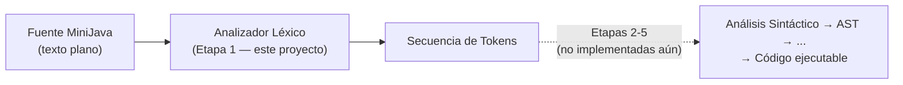
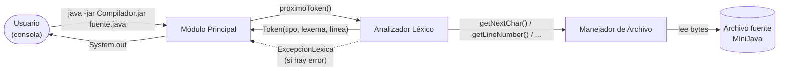
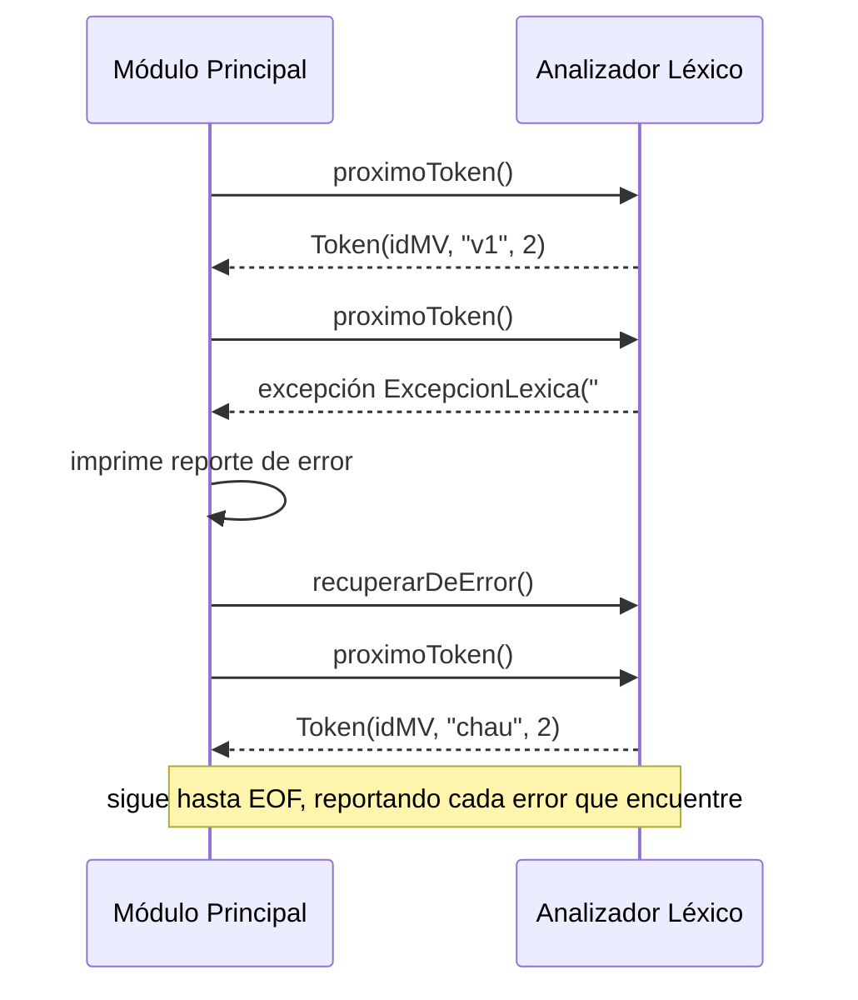
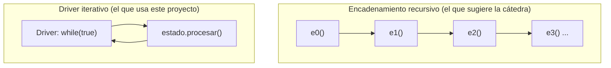
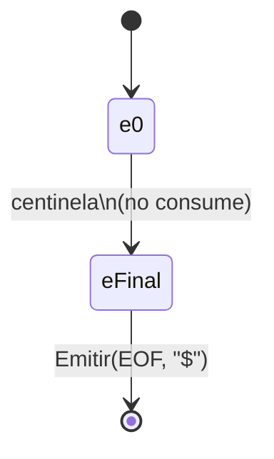
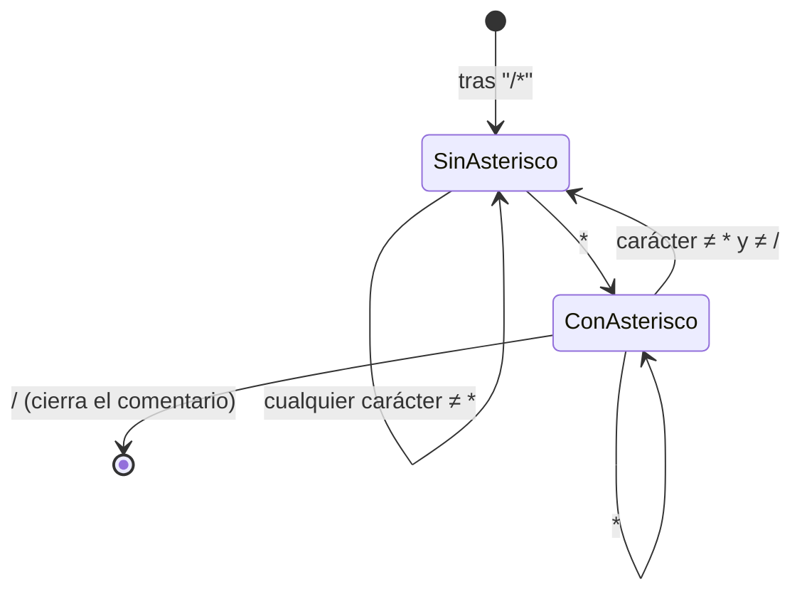

# Arquitectura del Compilador MiniJava — Etapa 1 (Analizador Léxico)

Este documento es autocontenido: alcanza para entender qué hace el proyecto, cómo están armadas sus
piezas y cómo interactúan entre sí **sin leer una sola línea de código**. Pensado para poder
explicárselo a un tercero (por ejemplo, un profesor) desde cero.

## 1. Qué es este proyecto

Es la Etapa 1 de un compilador para **MiniJava** — un subconjunto estricto de Java (sin excepciones,
sin hilos, sintaxis más rígida) — para la materia *Compiladores e Intérpretes* (UNS). El proyecto
completo va a tener 5 etapas; esta etapa construye únicamente el **Analizador Léxico**: el primer
paso de todo compilador, que convierte el texto plano del programa fuente en una secuencia de
*tokens* (palabras clave, identificadores, literales, símbolos, operadores).



## 2. Los tres componentes y cómo interactúan

La cátedra especifica un esquema de tres piezas. Dos las construye este proyecto; una tercera
(`SourceManager`, la interfaz de bajo nivel para leer el archivo) la provee la cátedra como punto de
partida, y este proyecto la **reemplaza por una implementación propia más eficiente** (ver §8, logro
*Manejador de Archivos Eficiente*) sin tocar el contrato original.



- **Módulo Principal** (`minijava.aplicacion.Main` + `ModuloPrincipal`): es la interfaz con el
  usuario. Recibe la ruta del archivo por línea de comandos, se la pasa al Manejador de Archivo,
  y va pidiéndole tokens al Analizador Léxico **uno por uno** hasta recibir el token `EOF` o
  agotar la entrada. Imprime cada token que recibe y, al final, el mensaje de éxito o los errores.
- **Analizador Léxico** (`minijava.lexico.AnalizadorLexico`): el corazón del proyecto. Reconoce un
  token cada vez que se le pide (`proximoToken()`), leyendo caracteres del Manejador de Archivo.
- **Manejador de Archivo** (`minijava.io.ManejadorDeArchivoEficiente`): abstrae el acceso de bajo
  nivel al archivo — entrega un carácter por vez, lleva la cuenta de línea/columna actuales, y sabe
  devolver el texto completo de la línea en curso (para los mensajes de error).

## 3. El ciclo de vida de una ejecución completa

Ejemplo real, tomado literal de la consigna de la cátedra. Fuente:

```java
"hola"
v1 + chau
if class}
```

Paso a paso:

1. El usuario ejecuta `java -jar Compilador.jar programa.java`.
2. `Main` delega en `ModuloPrincipal.ejecutar(rutaDelArchivo)`.
3. `ModuloPrincipal` abre el archivo con el Manejador de Archivo y crea un `AnalizadorLexico`.
4. Entra en un bucle: pide un token, lo imprime, repite hasta `EOF`.
5. Como no hay errores, al final imprime `[SinErrores]`.

Salida exacta producida:

```text
(litString,"hola",1)
(idMV,v1,2)
(op+,+,2)
(idMV,chau,2)
(pr_if,if,3)
(pr_class,class,3)
(llaveC,},3)
(EOF,$,3)
[SinErrores]
```

Si en cambio hubiera un error léxico (por ejemplo, un `#` en la línea 2), el ciclo cambia: el
Analizador Léxico lanza una excepción (`ExcepcionLexica`) en vez de devolver un token; el Módulo
Principal la captura, imprime un reporte de error, **se recupera** (salta ese carácter inválido) y
sigue pidiendo tokens — no corta la ejecución en el primer error (ver §8, logro *Multi-detección de
Errores*). Al terminar, si hubo algún error, no se imprime `[SinErrores]`.



## 4. Cómo el Analizador Léxico reconoce un token: el patrón State

### 4.1. Por qué esta técnica

La cátedra exige explícitamente la técnica **"Método por Estado"**: por cada estado de un Autómata
Finito (AF) se construye un componente de software que simula el comportamiento del autómata en ese
estado. Se implementó como el **patrón de diseño State** (uno de los patrones clásicos de diseño
orientado a objetos): cada estado del autómata es una clase con un único método,
`procesar(contexto)`, que decide a qué estado ir después según el carácter que está mirando.

La cátedra sugiere encadenar llamadas a método recursivamente (el estado *e1* llama al estado *e2*,
que llama al *e3*, etc.). Este proyecto usa la misma técnica pero con una diferencia deliberada: en
vez de que cada estado **llame** al siguiente (recursión), un **driver central** hace un bucle y va
pidiendo, en cada vuelta, "¿qué transición corresponde desde acá?" — sin apilar llamadas.

**Por qué importa la diferencia**: con la técnica recursiva, reconocer un token muy largo (un
comentario de 10.000 caracteres, un string larguísimo) apila una llamada de método por cada
carácter — con archivos grandes esto puede agotar la pila de la JVM (`StackOverflowError`). El driver
iterativo reconoce tokens de cualquier longitud sin ese riesgo, manteniendo exactamente la misma
lógica de "un componente por estado".



### 4.2. Los actores del driver

- **`EstadoLexico`**: el contrato común a todo estado — un único método `procesar(contexto)`.
- **`ContextoLexico`**: lo que todos los estados comparten y modifican — el carácter que se está
  mirando ahora mismo, el lexema que se viene armando, la línea actual. Expone operaciones como
  `avanzar()` (consumir el carácter actual y agregarlo al lexema) o `descartar()` (consumirlo sin
  agregarlo, para blancos y comentarios).
- **`ResultadoDeTransicion`**: lo que devuelve cada estado — o bien `Continuar(siguienteEstado)`
  (todavía no hay token completo, hay que seguir) o bien `Emitir(token)` (el token está listo).
- El **driver** (`AnalizadorLexico.proximoToken()`) arranca siempre en `EstadoInicial` y repite
  "preguntarle al estado actual qué hacer" hasta que alguno responda `Emitir`.

### 4.3. Ejemplo trazado: reconocer `>=`

Fuente: `>=543`. La cátedra usa este mismo ejemplo (con distinto alfabeto) para explicar por qué
hace falta lookahead de un carácter antes de decidir si el token es "mayor" (`>`) o "mayor o igual"
(`>=`) — dos tokens que comparten el primer carácter.

| Paso | Estado actual | Carácter que mira | Acción | Resultado |
|---|---|---|---|---|
| 1 | `EstadoInicial` | `>` | reconoce que `>` puede empezar un operador con sufijo opcional; lo consume | `Continuar(EstadoOperadorConSufijoOpcional.MAYOR)` |
| 2 | `EstadoOperadorConSufijoOpcional` (variante MAYOR) | `=` | el sufijo está presente: lo consume | `Emitir(Token(OP_MAYOR_IGUAL, ">=", línea 1))` |

Si en el paso 2 el carácter fuera `5` en vez de `=`, el mismo estado emitiría `Token(OP_MAYOR, ">",
línea 1)` **sin consumir** el `5` — ese carácter queda disponible para el próximo `proximoToken()`.
Este es el principio de **maximal munch**: se arma el lexema más largo posible, y recién cuando ya
no se puede seguir extendiendo se emite el token.

## 5. Manejo de errores

### 5.1. Cuándo y cómo se detecta un error

Un estado detecta un error léxico cuando, mirando el carácter actual, ninguna transición válida
existe desde ese estado (por ejemplo: `EstadoInicial` viendo un `#`, que no es letra, dígito, ni
ningún símbolo conocido). En ese momento se lanza `ExcepcionLexica`, que lleva: el lexema armado
hasta ese punto (incluyendo el carácter ofensivo), la línea, la columna, y el texto completo de la
línea fuente (para el reporte elegante).

### 5.2. Recuperación (logro Multi-detección de Errores)

La consigna base de la cátedra dice: *"al detectar un error deberá reportarse y finalizar la
ejecución"*. El logro *Multi-detección de Errores* cambia ese comportamiento: en vez de terminar,
el Módulo Principal captura la excepción, la reporta, le pide al Analizador Léxico que **se
recupere** (`recuperarDeError()` — descarta el carácter que rompió todo, o llega a EOF) y sigue
pidiendo tokens. Esto garantiza terminación: cada recuperación avanza al menos un carácter, así que
en el peor caso el análisis termina cuando se acaba el archivo.

### 5.3. Los dos formatos de reporte

Cuando hay error, se imprimen dos cosas:

1. Un **reporte legible** (logro *Reporte de Error Elegante*): la razón del error, la línea fuente
   completa, y un `^` apuntando exactamente a la columna del carácter ofensivo. Ejemplo real
   (tomado de la consigna, fuente `v1 + # chau` en la línea 2):

   ```text
   Error Léxico en línea 2: # no es un símbolo válido
   Detalle: v1 + # chau
                 ^
   [Error:#|2]
   ```

2. Un **código de error** de una sola línea, `[Error:Lexema|NroLinea]` — este es el contrato exacto
   que verifican los testers de la cátedra, y **no lleva columna** (la columna es sólo parte del
   reporte legible, que es un agregado propio más allá de lo pedido).

## 6. Especificación léxica formal

Notación: `Digito = [0-9]`, `LetraMayus = [A-Z]`, `LetraMin = [a-z]`, `Letra = LetraMayus|LetraMin`.
Todos los tokens del lenguaje, sin omitir ninguno (incluidos los símbolos de un solo carácter):

### 6.1. Identificadores y literales

| Token | Expresión regular | Ejemplo |
|---|---|---|
| `idGen` | `LetraMayus` | `A` |
| `idClase` | `LetraMayus (Letra\|Digito\|_)+` | `Alpha`, `A1` |
| `idMV` | `LetraMin (Letra\|Digito\|_)*` | `v1`, `x` |
| `intLiteral` | `Digito Digito? Digito? Digito? Digito? Digito? Digito? Digito? Digito?` (1 a 9 dígitos) | `543` |
| `charLiteral` | `'(X)' \| '\Y' \| '\U'` — `X` = cualquier carácter salvo `\` y `'`; `Y` = cualquier carácter salvo `u`; `U` = escape Unicode, ver abajo | `'a'`, `'\n'` |
| `litString` | `"(Z\|\W\|\U)*"` — `Z` = cualquier carácter salvo `\`, `"` y salto de línea; `W` = cualquier carácter salvo `u`; `U` = escape Unicode, ver abajo | `"hola"`, `"letra ñ"` |
| `floatLiteral` | ver §6.4 | `1.5`, `1e5`, `1.5E-3f` |

**Escape Unicode (`U` en las dos ER de arriba)**: `\u+H H H H` — `H` = dígito hexadecimal
(`[0-9a-fA-F]`). El marcador `u` se repite **una o más veces** (no una sola), semántica heredada tal
cual de Java (JLS §3.3) por la regla de `AGENTS.md` §0.1: `\u0041`, `\uu0041` y `\uuuu0041` son
todos escapes válidos y equivalentes. `EstadoMarcadorUnicode` consume la corrida de `u`; `EstadoEscapeUnicode`
exige exactamente 4 hex dígitos después de la última.

### 6.2. Puntuación (todos los símbolos de un carácter)

| Token | ER | Token | ER | Token | ER | Token | ER |
|---|---|---|---|---|---|---|---|
| `parenA` | `(` | `parenC` | `)` | `llaveA` | `{` | `llaveC` | `}` |
| `corcheteA` | `[` | `corcheteC` | `]` | `puntoYComa` | `;` | `coma` | `,` |
| `punto` | `.` | `dosPuntos` | `:` | | | | |

### 6.3. Operadores

| Token | ER | Token | ER |
|---|---|---|---|
| `op_mayor` | `>` | `op_mayorIgual` | `>=` |
| `op_menor` | `<` | `op_menorIgual` | `<=` |
| `op_negacion` | `!` | `op_distinto` | `!=` |
| `op_asignacion` | `=` | `op_igual` | `==` |
| `op+` | `+` | `op_incremento` | `++` |
| `op-` | `-` | `op_decremento` | `--` |
| `op_mult` | `*` | `op_div` | `/` |
| `op_modulo` | `%` | | |
| `op_and` | `&&` | `op_or` | `\|\|` |

`&` y `|` sueltos (sin duplicar) **no** son tokens válidos — no están en la lista de operadores de
la cátedra, así que producen error léxico.

### 6.4. `floatLiteral` en detalle

```text
floatLiteral = Digito+ . Digito* Exponente? Sufijo?
             | Digito+ Exponente Sufijo?
             | Digito+ Sufijo

Exponente = (e|E) (+|-)? Digito+
Sufijo    = f|F|d|D
```

Igual que los floats de Java, con la salvedad de que **siempre** empiezan con un dígito (a
diferencia de Java, `.5` no es un float válido en MiniJava — es el token `punto` seguido de
`intLiteral`).

### 6.5. Palabras clave — por qué no tienen autómata propio

Las 22 palabras clave (`class`, `extends`, `interface`, `implements`, `static`, `boolean`, `char`,
`int`, `void`, `public`, `if`, `else`, `while`, `return`, `var`, `this`, `new`, `null`, `true`,
`false`, `float`, `double` — las últimas dos no figuran en los PDFs de la cátedra; se agregan por la
regla "ante la duda, como en Java" de `AGENTS.md` §0.1, confirmado además directamente por el
profesor) **no** se modelan con un autómata dedicado — hacerlo requeriría casi un estado por letra y
fusionar esos estados con los del autómata de identificadores, generando un autómata enorme y frágil.
En cambio, se usa la técnica estándar: se reconoce un `idMV` normalmente y, antes de emitirlo, se
consulta una tabla de lookup; si el lexema coincide con una palabra clave, se emite esa palabra
clave. **Caso especial**: `float` y `double` son dos lexemas distintos pero un único `TipoDeToken`
(`PR_FLOAT`) — el profesor indicó tratarlos como un solo tipo de dato, así que la tabla mapea ambos
lexemas al mismo tipo. Sigue siendo un solo lookup; la única particularidad es que dos entradas del
mapa apuntan al mismo valor en vez de a valores distintos.

### 6.6. Tres casos especiales — corrección de una confusión anterior

En un intento anterior de este proyecto se afirmó, incorrectamente, que estos tres casos "no eran
expresables con precisión" como expresión regular / autómata finito. Es falso — los tres son
perfectamente regulares, sólo que ninguno se modela con **un único estado que se auto-referencia en
bucle** (la forma más simple de AF), sino con más estados o con clases de caracteres:

**El End Of File.** Es una ER de un solo símbolo sobre el carácter centinela que devuelve el
Manejador de Archivo cuando se acaba el contenido (`SourceManager.END_OF_FILE`, el carácter ASCII
26). El autómata es una única transición: `e0 --centinela--> e_final`. Lo único distinto respecto a
cualquier otro token es un detalle del *driver*, no del lenguaje: esa transición específica **no
avanza la posición de lectura** (no tendría sentido "consumir" el fin de archivo).



**El comentario multilínea.** Tiene una ER exacta y estándar — la misma que usan herramientas como
`lex`/`flex` para comentarios de C:

```text
/\*  ( [^*] | \*+ [^*/] )*  \*+  /
```

En palabras: tras el `/*` de apertura, el contenido es cualquier cantidad de (un carácter que no sea
`*`) o (uno o más `*` seguidos de un carácter que no sea ni `*` ni `/`), y cierra con uno o más `*`
seguidos de `/`. El autómata equivalente tiene exactamente dos estados relevantes dentro del
comentario — "no vi un `*` recién" y "sí vi un `*` recién" — que es exactamente lo que implementa
`EstadoComentarioMultilinea` en el código (el campo `ultimoFueAsterisco`):



**El límite de 9 dígitos de `intLiteral`.** Toda repetición acotada (entre 1 y N repeticiones) es
regular — no hace falta ningún truco: alcanza con una cadena lineal de 9 estados, todos terminales,
sin bucle. La ER es simplemente `Digito Digito? Digito? Digito? Digito? Digito? Digito? Digito?
Digito?` (un dígito obligatorio más 8 opcionales) — equivalente a la notación de repetición acotada
`Digito{1,9}` que el profesor describió como "una estrella de Kleene de aridad 1-9": misma ER, sólo
que escrita con el operador de cota en vez de expandir los 9 términos a mano. Ojo con la diferencia:
`Digito*` (Kleene sin cota) sería **incorrecto** acá — el límite de 9 es exactamente lo que se está
modelando, así que la cota tiene que estar explícita, ya sea expandida o como `{1,9}`. La implementación
real usa una variante
observacionalmente equivalente pero más simple de programar: un único estado con bucle (como el de
un entero sin límite) que consume **toda** la corrida de dígitos y, recién al terminar, valida por
código que no haya más de 9 — necesario además porque, si el siguiente carácter es un `.` o una
`e`/`E`, la corrida de dígitos continúa hacia un `floatLiteral` (que no tiene ese límite), y cortar
en el noveno dígito rompería esa continuación.

## 7. Los 8 logros de la Etapa 1

| Logro | Qué exige | Cómo se resuelve |
|---|---|---|
| Entrega Anticipada | Entregar 48hs antes de la fecha límite | Hito de calendario, no de código |
| Imbatibilidad Léxica | Pasar toda la batería de pruebas de la cátedra | Consecuencia de la robustez de la suite propia |
| Good Job! I | Que la entrega tenga sólo errores menores | Idem |
| Manejador de Archivos Eficiente | Leer char a char (no por líneas), sólo con `java.io` | `ManejadorDeArchivoEficiente` — ver §8 para el porqué es obligatorio, no opcional |
| Floats I | Reconocer literales float, con la salvedad de empezar siempre con dígito | Estados `EstadoFloat*` (§6.4) |
| Unicodes | Caracteres Unicode crudos en char/string, más la secuencia escapada de 4 hex dígitos | Los estados de char/string aceptan cualquier carácter no reservado; `EstadoMarcadorUnicode` consume el marcador `u` (una o más veces — JLS §3.3, regla "ante la duda, como en Java" de `AGENTS.md` §0.1) y `EstadoEscapeUnicode` valida los 4 hex que le siguen |
| Multi-detección de Errores | No terminar en el primer error, reportar todos en una corrida | `AnalizadorLexico.recuperarDeError()` + bucle de recuperación en `ModuloPrincipal` (§5.2) |
| Reporte de Error Elegante | Mostrar la línea y apuntar con `^` al error | `FormateadorDeError` (§5.3) — este proyecto además agrega la **columna**, más allá de lo pedido |

## 8. Por qué el Manejador de Archivo de la cátedra no sirve tal cual

La cátedra provee una interfaz `SourceManager` (con los métodos `open`, `close`, `getNextChar`,
`getLineNumber`) y una implementación de referencia, `SourceManagerImpl`, que lee **por líneas**
(`readLine()`) y usa `reader.ready()` para saber si queda contenido. Ese diseño **falla contra los
propios casos de ejemplo de la cátedra**: un archivo de 21 saltos de línea que termina en newline
debería reportar el EOF en la línea 22, pero `reader.ready()` hace que lo reporte en la 21. También
explota (`NullPointerException`) con un archivo vacío.

Por eso, aunque en la consigna "Manejador de Archivos Eficiente" figura como un logro opcional, en
la práctica es un **requisito** para pasar los tests de la cátedra: este proyecto implementa
`ManejadorDeArchivoEficiente`, que lee char a char sobre un buffer propio, respetando exactamente el
mismo contrato (`SourceManager`, sin modificarlo) más una extensión (`ManejadorDeArchivo`) que agrega
`getColumnNumber()` y `getCurrentLineText()` — necesarios para el Reporte de Error Elegante, y
explícitamente autorizados por la consigna ("puede que por algún otro logro sea necesario expandir
la interface provista").

## 9. Estructura de paquetes — quién vive dónde

```
compilador/
├── pom.xml                          ← build Maven: JUnit 5 + vintage, JaCoCo, jqwik, PIT
├── resources/
│   ├── sinErrores/                  ← casos de test sin errores (con oráculo //#lexema,línea)
│   ├── conErrores/                  ← casos de test con error (con oráculo // [Error:lexema|línea])
│   └── regresion/                   ← casos que reprodujeron un bug real (regresión permanente)
└── src/
    ├── main/java/
    │   └── minijava/
    │       ├── aplicacion/          ← Main, ModuloPrincipal (§2-3)
    │       ├── io/                  ← SourceManager + SourceManagerImpl (contenido ORIGINAL de
    │       │                          la cátedra, sólo se movió el `package`), ManejadorDeArchivo
    │       │                          + ManejadorDeArchivoEficiente (§8)
    │       ├── tokens/              ← Token, TipoDeToken (los ~55 tipos de token)
    │       ├── errores/             ← ExcepcionLexica, FormateadorDeError (§5)
    │       ├── salida/              ← interfaz Salida (ver §10) + SalidaEstandar
    │       └── lexico/              ← AnalizadorLexico, ContextoLexico, TablaDePalabrasClave
    │           └── estados/         ← un archivo por estado del autómata (§4)
    └── test/java/
        ├── catedra/                 ← los 2 testers originales de la cátedra, sin más cambio que el
        │                              paquete y el import de Main (no son entregables, se pueden
        │                              editar libremente, pero se dejaron tal cual las entregó la cátedra)
        └── minijava/                ← tests propios, un paquete espejo por cada uno de arriba
```

## 10. Por qué `Salida` es una interfaz

Toda la salida del programa pasa por una interfaz propia (`minijava.salida.Salida`), en vez de
llamar a `System.out` directamente en cada punto del código. Esto no cambia el comportamiento hacia
afuera — la consigna exige que toda la salida real use `System.out`, y `SalidaEstandar` (la única
implementación que usa `Main`) efectivamente delega ahí — pero permite testear el Módulo Principal
completo con una implementación en memoria (`SalidaEnMemoria`, usada sólo en los tests) que guarda
las líneas impresas en una lista para poder comparar con `assertEquals` en vez de tener que capturar
y parsear el stream global de la JVM.

## 11. Cómo correr y verificar el proyecto

```bash
cd compilador
mvn test        # corre la suite propia + los 2 testers de la cátedra en la misma pasada
mvn verify       # además corre el chequeo de cobertura JaCoCo
mvn package      # genera target/minijava-compilador-*.jar

java -jar target/minijava-compilador-*.jar resources/sinErrores/lexSinErrores01.java
```

Desde IntelliJ IDEA: abrir la carpeta `compilador/` (detecta el `pom.xml` solo). El *working
directory* de los tests debe ser `compilador/` (donde está `resources/`), que es el default cuando
IntelliJ importa el proyecto Maven correctamente.

## 12. Ver también

- [`patron-state.md`](patron-state.md) — profundiza el §4 de este documento: cómo interactúan
  `EstadoLexico`, `ContextoLexico`, `Continuar`/`Emitir` y el driver, con el criterio exacto de
  cuándo cada estado es un singleton compartido y cuándo se construye con `new`.

Este documento es autocontenido (§ arriba) y no depende de `AGENTS.md` para entenderse. Es
`AGENTS.md` el que enlaza hacia acá, no al revés — ver ahí la memoria operativa completa del
proyecto (convenciones de la cátedra, invariantes técnicas, estrategia de testing, historial en
`git log`).
