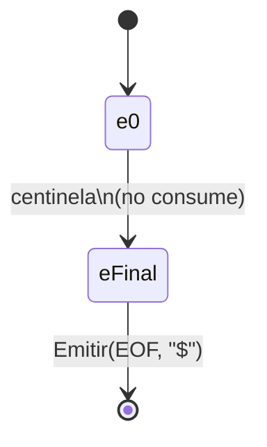
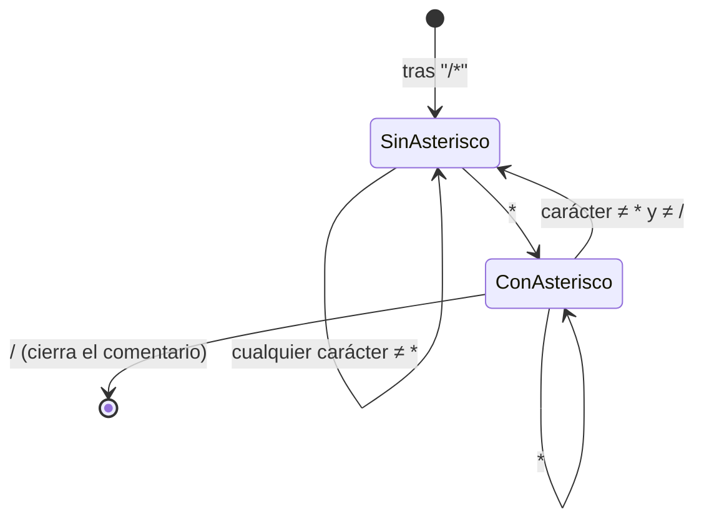

# Especificación léxica formal — Etapa 1

Documento autocontenido: expresiones regulares exactas de **todos** los tokens de MiniJava, sin
omitir ninguno (incluidos los símbolos de un solo carácter), con sus autómatas. Complementa
[`arquitectura.md`](arquitectura.md) (que referencia a este archivo desde su sección de manejo de
tokens) — para el resto del proyecto (ciclo de vida, patrón State, logros), ver ese documento.

Notación: `Digito = [0-9]`, `LetraMayus = [A-Z]`, `LetraMin = [a-z]`, `Letra = LetraMayus|LetraMin`.

## 1. Identificadores y literales

| Token | Expresión regular | Ejemplo |
|---|---|---|
| `idGen` | `LetraMayus` | `A` |
| `idClase` | `LetraMayus (Letra\|Digito\|_)+` | `Alpha`, `A1` |
| `idMV` | `LetraMin (Letra\|Digito\|_)*` | `v1`, `x` |
| `intLiteral` | `Digito Digito? Digito? Digito? Digito? Digito? Digito? Digito? Digito?` (1 a 9 dígitos) | `543` |
| `charLiteral` | `'(X)' \| '\Y' \| '\U'` — `X` = cualquier carácter salvo `\` y `'`; `Y` = cualquier carácter salvo `u`; `U` = escape Unicode, ver abajo | `'a'`, `'\n'` |
| `litString` | `"(Z\|\W\|\U)*"` — `Z` = cualquier carácter salvo `\`, `"` y salto de línea; `W` = uno de `b s t n f r " ' \` o un dígito octal `0`-`7`; `U` = escape Unicode, ver abajo | `"hola"`, `"letra ñ"` |
| `floatLiteral` | ver §4 | `1.5`, `1e5`, `1.5E-3f` |

**Escape Unicode (`U` en las dos ER de arriba)**: `\u+H H H H` — `H` = dígito hexadecimal
(`[0-9a-fA-F]`). El marcador `u` se repite **una o más veces** (no una sola), semántica heredada tal
cual de Java (JLS §3.3, verificado contra la especificación — ver `AGENTS.md` §0.1 y
`agents/investigacion.md`): `\u0041`, `\uu0041` y `\uuuu0041` son todos escapes válidos y
equivalentes. `EstadoMarcadorUnicode` consume la corrida de `u`; `EstadoEscapeUnicode` exige
exactamente 4 hex dígitos después de la última.

**Por qué `litString` restringe los escapes de un carácter (`W`) y `charLiteral` no**: la cátedra
autoriza explícitamente `charLiteral` a aceptar cualquier carácter tras la barra invertida
(`Aspectos Lexicos MiniJava 2026.pdf` §2.3.2: "`'\x'` con `x` cualquier carácter"). Para `litString`
no hay esa autorización explícita — la consigna sólo dice, citando a Java, que `\"` es válido dentro
del string. Ante esa falta de especificación, aplica la regla "ante la duda, como en Java"
(`AGENTS.md` §0.1): el conjunto de escapes válidos es el que define el JLS §3.10.7 —
`b s t n f r " ' \` y un dígito octal `0`-`7` — cualquier otro carácter tras la barra dentro de un
string es un error léxico. `"a\q"` es inválido; `"a\s b"`, `"a\7"` son válidos.

## 2. Puntuación (todos los símbolos de un carácter)

| Token | ER | Token | ER | Token | ER | Token | ER |
|---|---|---|---|---|---|---|---|
| `parenA` | `(` | `parenC` | `)` | `llaveA` | `{` | `llaveC` | `}` |
| `corcheteA` | `[` | `corcheteC` | `]` | `puntoYComa` | `;` | `coma` | `,` |
| `punto` | `.` | `dosPuntos` | `:` | | | | |

## 3. Operadores

| Token | ER | Token | ER |
|---|---|---|---|
| `op_mayor` | `>` | `op_mayorIgual` | `>=` |
| `op_menor` | `<` | `op_menorIgual` | `<=` |
| `op_negacion` | `!` | `op_distinto` | `!=` |
| `op_asignacion` | `=` | `op_igual` | `==` |
| `op+` | `+` | `op_incremento` | `++` |
| `op-` | `-` | `op_decremento` | `--` |
| `op_mult` | `*` | `op_div` | `/` |
| `op_modulo` | `%` | | |
| `op_and` | `&&` | `op_or` | `\|\|` |

`&` y `|` sueltos (sin duplicar) **no** son tokens válidos — no están en la lista de operadores de
la cátedra, así que producen error léxico.

## 4. `floatLiteral` en detalle

```text
floatLiteral = Digito+ . Digito* Exponente? Sufijo?
             | Digito+ Exponente Sufijo?
             | Digito+ Sufijo

Exponente = (e|E) (+|-)? Digito+
Sufijo    = f|F|d|D
```

Igual que los floats de Java, con la salvedad de que **siempre** empiezan con un dígito (a
diferencia de Java, `.5` no es un float válido en MiniJava — es el token `punto` seguido de
`intLiteral`).

## 5. Palabras clave — por qué no tienen autómata propio

Las 21 palabras clave (`class`, `extends`, `interface`, `implements`, `static`, `boolean`, `char`,
`int`, `void`, `public`, `if`, `else`, `while`, `return`, `var`, `this`, `new`, `null`, `true`,
`false`, `float` — la última no figura en los PDFs de la cátedra; se agrega por confirmación directa
del profesor) **no** se modelan con un autómata dedicado — hacerlo requeriría casi un estado por
letra y fusionar esos estados con los del autómata de identificadores, generando un autómata enorme
y frágil. En cambio, se usa la técnica estándar: se reconoce un `idMV` normalmente y, antes de
emitirlo, se consulta una tabla de lookup; si el lexema coincide con una palabra clave, se emite esa
palabra clave.

**`double` no es palabra clave.** MiniJava tiene un único tipo de dato de punto flotante (`float`,
por indicación del profesor) — `double` sigue siendo un identificador común. Los sufijos `f`/`F`/
`d`/`D` del literal float (§4, heredados de Java) son la única forma en que "double" aparece en la
sintaxis de MiniJava, y no requieren que la palabra `double` sea reservada.

## 6. Tres casos especiales — corrección de una confusión anterior

En un intento anterior de este proyecto se afirmó, incorrectamente, que estos tres casos "no eran
expresables con precisión" como expresión regular / autómata finito. Es falso — los tres son
perfectamente regulares, sólo que ninguno se modela con **un único estado que se auto-referencia en
bucle** (la forma más simple de AF), sino con más estados o con clases de caracteres:

**El End Of File.** Es una ER de un solo símbolo sobre el carácter centinela que devuelve el
Manejador de Archivo cuando se acaba el contenido (`SourceManager.END_OF_FILE`, el carácter ASCII
26). El autómata es una única transición: `e0 --centinela--> e_final`. Lo único distinto respecto a
cualquier otro token es un detalle del *driver*, no del lenguaje: esa transición específica **no
avanza la posición de lectura** (no tendría sentido "consumir" el fin de archivo).



**El comentario multilínea.** Tiene una ER exacta y estándar — la misma que usan herramientas como
`lex`/`flex` para comentarios de C:

```text
/\*  ( [^*] | \*+ [^*/] )*  \*+  /
```

En palabras: tras el `/*` de apertura, el contenido es cualquier cantidad de (un carácter que no sea
`*`) o (uno o más `*` seguidos de un carácter que no sea ni `*` ni `/`), y cierra con uno o más `*`
seguidos de `/`. El autómata equivalente tiene exactamente dos estados relevantes dentro del
comentario — "no vi un `*` recién" y "sí vi un `*` recién" — que es exactamente lo que implementa
`EstadoComentarioMultilinea` en el código (el campo `ultimoFueAsterisco`):



**El límite de 9 dígitos de `intLiteral`.** Toda repetición acotada (entre 1 y N repeticiones) es
regular — no hace falta ningún truco: alcanza con una cadena lineal de 9 estados, todos terminales,
sin bucle. La ER es simplemente `Digito Digito? Digito? Digito? Digito? Digito? Digito? Digito?
Digito?` (un dígito obligatorio más 8 opcionales) — equivalente a la notación de repetición acotada
`Digito{1,9}` que el profesor describió como "una estrella de Kleene de aridad 1-9": misma ER, sólo
que escrita con el operador de cota en vez de expandir los 9 términos a mano. Ojo con la diferencia:
`Digito*` (Kleene sin cota) sería **incorrecto** acá — el límite de 9 es exactamente lo que se está
modelando, así que la cota tiene que estar explícita, ya sea expandida o como `{1,9}`. La
implementación real usa una variante observacionalmente equivalente pero más simple de programar: un
único estado con bucle (como el de un entero sin límite) que consume **toda** la corrida de dígitos
y, recién al terminar, valida por código que no haya más de 9 — necesario además porque, si el
siguiente carácter es un `.` o una `e`/`E`, la corrida de dígitos continúa hacia un `floatLiteral`
(que no tiene ese límite), y cortar en el noveno dígito rompería esa continuación.

## Ver también

- [`arquitectura.md`](arquitectura.md) — visión completa del proyecto: componentes, ciclo de vida,
  patrón State, manejo de errores, logros.
- [`patron-state.md`](patron-state.md) — detalle del patrón State y sus piezas.
