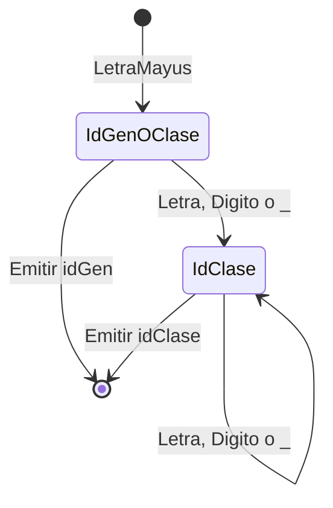
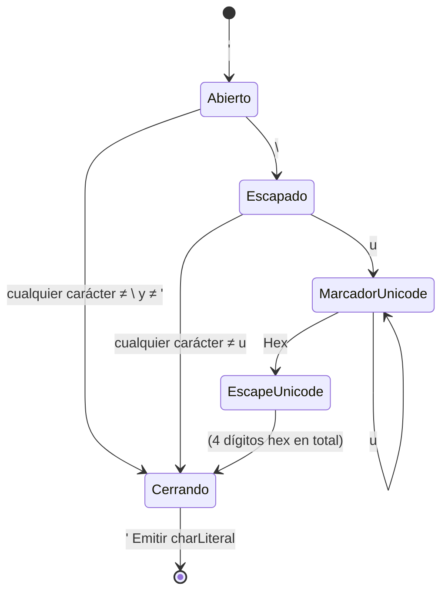
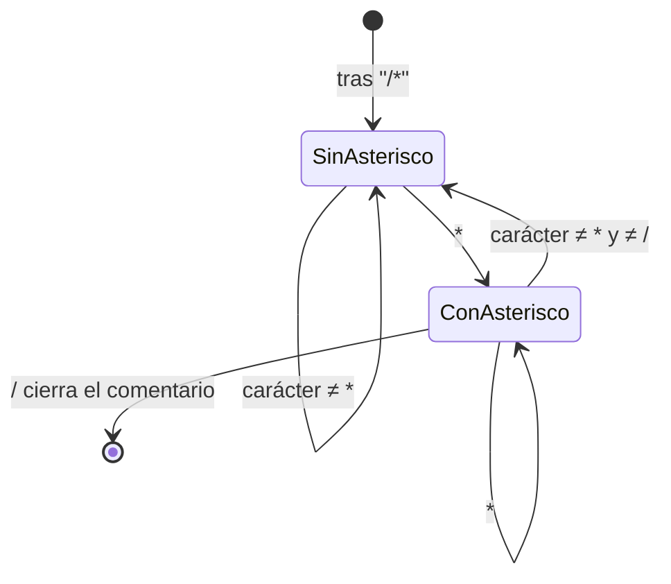
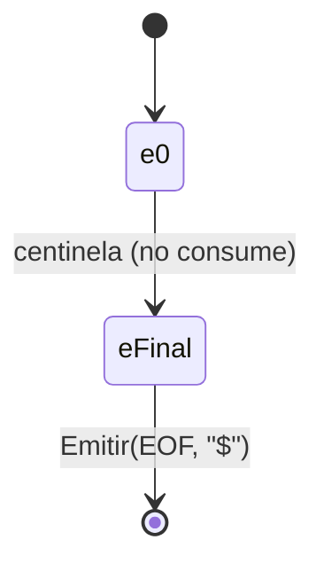

# Especificación léxica formal

Documento autocontenido: la expresión regular exacta de **todos** los tokens de MiniJava, sin omitir
ninguno, con sus autómatas y con lo que queda deliberadamente afuera del lenguaje.

Notación usada en todo el documento:

```text
Digito     = [0-9]
LetraMayus = [A-Z]
LetraMin   = [a-z]
Letra      = LetraMayus | LetraMin
Hex        = [0-9a-fA-F]
```

Un apunte sobre "letra" y "dígito": el proyecto los reconoce con `Character.isLetter` y
`Character.isDigit` de Java, que abarcan más que el ASCII. Las consecuencias de esa elección —y por
qué se tomó— están en [`decisiones.md`](decisiones.md) §7.

## 1. Los 56 tokens, de un vistazo

| Familia | Cantidad | Tokens |
|---|---|---|
| Palabras clave | 21 | `pr_class`, `pr_extends`, `pr_interface`, `pr_implements`, `pr_static`, `pr_boolean`, `pr_char`, `pr_int`, `pr_void`, `pr_public`, `pr_if`, `pr_else`, `pr_while`, `pr_return`, `pr_var`, `pr_this`, `pr_new`, `pr_null`, `pr_true`, `pr_false`, `pr_float` |
| Identificadores | 3 | `idClase`, `idGen`, `idMV` |
| Literales | 4 | `intLiteral`, `charLiteral`, `litString`, `floatLiteral` |
| Puntuación | 10 | `parenA`, `parenC`, `llaveA`, `llaveC`, `corcheteA`, `corcheteC`, `puntoYComa`, `coma`, `punto`, `dosPuntos` |
| Operadores | 17 | `op_mayor`, `op_menor`, `op_negacion`, `op_asignacion`, `op_igual`, `op_mayorIgual`, `op_menorIgual`, `op_distinto`, `op_and`, `op_or`, `op_modulo`, `op+`, `op-`, `op_mult`, `op_div`, `op_incremento`, `op_decremento` |
| Fin de archivo | 1 | `EOF` |

Los nombres de la columna derecha son literales: son exactamente los que se imprimen en la salida,
porque el formato que fija la cátedra es `(NombreToken,Lexema,NroLinea)`.

## 2. Identificadores

| Token | Expresión regular | Ejemplos | Contraejemplos |
|---|---|---|---|
| `idGen` | `LetraMayus` | `A`, `T` | `AB` (es `idClase`) |
| `idClase` | `LetraMayus (Letra \| Digito \| _)+` | `Alpha`, `A1`, `Mi_Clase` | `A` (es `idGen`) |
| `idMV` | `LetraMin (Letra \| Digito \| _)*` | `v1`, `x`, `mi_metodo` | `_x` (empieza con guion bajo) |

`idGen` (el parámetro de tipo genérico, la `T` de `List<T>`) y `idClase` comparten el primer
carácter, así que se distinguen por longitud: **una** mayúscula sola es `idGen`; una mayúscula
seguida de al menos un carácter más es `idClase`. El autómata lo resuelve con un estado intermedio,
`EstadoIdGenOClase`, que es terminal —si el token termina ahí, es `idGen`— y que transiciona a
`EstadoIdClase` en cuanto aparece un carácter más.



Un identificador que empieza con minúscula es siempre `idMV`, **salvo** que su lexema completo
coincida con una de las 21 palabras clave: en ese caso se emite la palabra clave. Ese chequeo es una
consulta a una tabla, no un autómata — ver §7.

## 3. Literales

### 3.1. `intLiteral`

```text
intLiteral = Digito Digito? Digito? Digito? Digito? Digito? Digito? Digito? Digito?
```

Uno a nueve dígitos. Equivale a la notación de repetición acotada `Digito{1,9}`.

**El límite se valida después, no durante.** El estado consume la corrida **completa** de dígitos y
recién al terminar comprueba que no haya más de nueve. La razón es que si el carácter siguiente a la
corrida es un `.` o una `e`/`E`, la corrida continúa hacia un `floatLiteral` — que **no** tiene ese
límite —, y cortar en el noveno dígito rompería esa continuación. Por eso `1234567890.5` es un float
válido de diez dígitos en la parte entera, mientras que `1234567890` solo es un error.

### 3.2. `charLiteral`

```text
charLiteral = ' X '  |  ' \ Y '  |  ' \ U '

X = cualquier carácter salvo \ y '
Y = cualquier carácter salvo u
U = escape Unicode (ver §3.5)
```

La cadena vacía (`''`) **no** está en ninguna alternativa: es un error. Y `'\q'` **sí** es válido,
con valor `q` — es una permisividad explícita de la cátedra, más laxa que Java.



Los tres caminos que **no** llegan a `[*]` son los tres errores del charLiteral: `''` (char vacío),
un fin de línea o de archivo antes de cerrar (`sin cerrar`), y un carácter cualquiera donde debía ir
la comilla de cierre (`mal formado`).

### 3.3. `litString`

```text
litString = " ( Z | \ W | \ U )* "

Z = cualquier carácter salvo \, " y salto de línea
W = uno de: b s t n f r " ' \  o un dígito octal 0-7
U = escape Unicode (ver §3.5)
```

**Por qué `litString` restringe los escapes (`W`) y `charLiteral` no.** La cátedra autoriza
explícitamente al `charLiteral` a aceptar cualquier carácter tras la barra invertida
(`Aspectos Lexicos MiniJava 2026.pdf` §2.3.2). Para `litString` **no** hay esa autorización: §2.3.3
sólo cita a Java para el caso puntual de `\"`. Ante esa falta de especificación aplica "ante la duda,
como en Java", y el conjunto válido es el del JLS §3.10.7. Por eso `"a\q"` es un error léxico
mientras que `'\q'` es válido — una asimetría intencional que viene de que la cátedra especificó una
de las dos y no la otra.

Un `litString` **no puede contener un salto de línea real**: si aparece uno antes de la comilla de
cierre, el literal quedó sin cerrar y es error.

### 3.4. `floatLiteral`

```text
floatLiteral = Digito+ . Digito* Exponente? Sufijo?
             | Digito+ Exponente Sufijo?
             | Digito+ Sufijo

Exponente = (e|E) (+|-)? Digito+
Sufijo    = f | F | d | D
```

Igual que los floats de Java, con **una** salvedad que fija la consigna: siempre empiezan con un
dígito. Por eso `.5` no es un float en MiniJava — es el token `punto` seguido de `intLiteral(5)`.

Ninguna de las tres partes tiene límite de dígitos, a diferencia del `intLiteral`. El desarrollo de
por qué, con la verificación contra `javac`, está en [`decisiones.md`](decisiones.md) §3.3.

Dos casos que valen como error, sin retroceso: `1e` y `1.5e+`, un exponente anunciado y sin dígitos.
No hay backtracking a un token más corto — una vez consumida la `e` como inicio de exponente, el
literal está comprometido.

### 3.5. El escape Unicode

```text
U = \ u+ Hex Hex Hex Hex
```

El marcador `u` se repite **una o más veces**: `\u0041`, `\uu0041` y `\uuuu0041` son todos válidos y
equivalentes. Es semántica heredada tal cual de Java (JLS §3.3) y no se adivinó: se verificó contra
la especificación. Existe porque el pre-procesador de escapes de Java necesita poder representar un
`\u` literal sin re-traducirlo.

`EstadoMarcadorUnicode` consume la corrida de `u`; `EstadoEscapeUnicode` exige exactamente cuatro
dígitos hexadecimales después de la última. Ambos estados saben **a qué estado volver** al terminar,
porque el mismo escape sirve dentro de un `charLiteral` y dentro de un `litString`.

## 4. Puntuación

| Token | ER | Token | ER | Token | ER | Token | ER |
|---|---|---|---|---|---|---|---|
| `parenA` | `(` | `parenC` | `)` | `llaveA` | `{` | `llaveC` | `}` |
| `corcheteA` | `[` | `corcheteC` | `]` | `puntoYComa` | `;` | `coma` | `,` |
| `punto` | `.` | `dosPuntos` | `:` | | | | |

Los diez se reconocen con una tabla `Map<Character, TipoDeToken>` consultada desde el estado inicial:
son tokens de un solo carácter, sin lookahead, y no justifican un estado propio.

## 5. Operadores

| Token | ER | Token | ER |
|---|---|---|---|
| `op_mayor` | `>` | `op_mayorIgual` | `>=` |
| `op_menor` | `<` | `op_menorIgual` | `<=` |
| `op_negacion` | `!` | `op_distinto` | `!=` |
| `op_asignacion` | `=` | `op_igual` | `==` |
| `op+` | `+` | `op_incremento` | `++` |
| `op-` | `-` | `op_decremento` | `--` |
| `op_mult` | `*` | `op_div` | `/` |
| `op_modulo` | `%` | | |
| `op_and` | `&&` | `op_or` | `\|\|` |

Se dividen en tres grupos por su comportamiento en el autómata:

**Con sufijo opcional** (`>`, `<`, `!`, `=`, `+`, `-`): el primer carácter ya forma un token válido,
y el segundo lo extiende. El estado que los reconoce es **terminal**: si el sufijo no viene, emite el
token corto sin consumir el carácter que miró. Los seis los cubre un único estado parametrizado.

**Con segundo carácter obligatorio** (`&&`, `||`): `&` y `|` sueltos **no** son tokens válidos — no
están en la lista de operadores de la cátedra. El estado que los reconoce es **no terminal**: si el
segundo carácter no viene, es un error léxico.

**De un solo carácter** (`*`, `%`, y `/` cuando no abre un comentario): se emiten directamente.

## 6. Lo que no es un token

### 6.1. Separadores

Espacio, tabulador y salto de línea. Se descartan sin agregarse a ningún lexema.

El form feed (`\f`) y el tabulador vertical (`\v`) **no** son separadores en MiniJava, aunque sí lo
son en Java: no están en la lista de la cátedra. Producen error léxico.

### 6.2. Comentarios

De línea (`// ... hasta el fin de línea`) y multilínea (`/* ... */`). Se descartan por completo: no
producen token y su contenido no forma parte de ningún lexema.

Un comentario multilínea **sin cerrar** es un error léxico, y se reporta con el lexema `/*` y la
línea de **apertura** del comentario, no la del fin de archivo donde se descubrió.

La ER del comentario multilínea es exacta y estándar — la misma que usan `lex`/`flex` para los
comentarios de C:

```text
/\*  ( [^*] | \*+ [^*/] )*  \*+  /
```

En palabras: tras el `/*`, el contenido es cualquier cantidad de (un carácter que no sea `*`) o (uno
o más `*` seguidos de un carácter que no sea ni `*` ni `/`), y cierra con uno o más `*` seguidos de
`/`. El autómata equivalente tiene exactamente dos estados relevantes dentro del comentario:



## 7. Las palabras clave no tienen autómata propio

Las 21 palabras reservadas se reconocen como un `idMV` común y, antes de emitir el token, se consulta
una tabla de lookup. Si el lexema coincide, se emite la palabra clave.

Modelarlas con estados dedicados exigiría casi un estado por letra de cada palabra, fusionados con
los estados de identificador — decenas de estados frágiles para algo que una tabla resuelve en tiempo
constante. Es la técnica que la cátedra recomienda explícitamente (Clase 02, slides 62-63).

**`float` está en la lista aunque no figure en ningún PDF de la cátedra**: se agrega por confirmación
directa del profesor. **`double` no está**: MiniJava tiene un único tipo de punto flotante, pero eso
no convierte a la palabra `double` en reservada — sigue siendo un `idMV` común. Ver
[`decisiones.md`](decisiones.md) §3.1.

## 8. El token `EOF`

Es un token más, con lexema `$`. Su ER es trivial: un solo símbolo sobre el carácter centinela que
devuelve el manejador de archivo cuando se acabó el contenido.



Lo único distinto respecto de cualquier otro token es un detalle del **driver**, no del lenguaje: esa
transición **no avanza la posición de lectura**. No tendría sentido "consumir" el fin de archivo, y
además el Módulo Principal podría pedir otro token después.

**La línea del EOF** es `cantidad de saltos de línea consumidos + 1`. Suena obvio y no lo es: es la
regla que la implementación de referencia de la cátedra viola, y la razón por la que hubo que
reemplazarla — ver [`manejador-de-archivo.md`](manejador-de-archivo.md) §2.1.

## 9. Sobre la regularidad de los tres casos "especiales"

En una versión anterior de esta documentación se afirmó, **incorrectamente**, que el EOF, el
comentario multilínea y el límite de 9 dígitos "no eran expresables con precisión" como expresión
regular o autómata finito. Es falso, y queda corregido acá porque el error de concepto vale la pena
señalarlo:

- **El EOF** es una ER de un solo símbolo (§8). Lo especial es del driver, no del lenguaje.
- **El comentario multilínea** tiene la ER exacta de §6.2, que no es una aproximación.
- **El límite de 9 dígitos** es trivialmente regular: toda repetición **acotada** lo es. La ER es una
  cadena lineal de nueve estados terminales sin bucle, o equivalentemente `Digito{1,9}` — lo que el
  profesor describió como "una estrella de Kleene de aridad 1-9". Ojo con la diferencia: `Digito*`
  (Kleene **sin** cota) sería incorrecto acá, porque el límite de 9 es justamente lo que se está
  modelando.

La implementación usa, para ese último caso, una variante observacionalmente equivalente pero más
simple: un único estado con bucle que consume toda la corrida y valida el largo al final. Ver §3.1
para por qué esa forma, además, es la única que no rompe la continuación hacia un float.

## 10. Ver también

- [`arquitectura.md`](arquitectura.md) — dónde encaja el léxico en el conjunto.
- [`patron-state.md`](patron-state.md) — cómo cada uno de estos autómatas se convierte en código.
- [`decisiones.md`](decisiones.md) — de dónde sale cada regla de este documento.
- [`manejo-de-errores.md`](manejo-de-errores.md) — qué pasa cuando la entrada no matchea ninguna ER.
