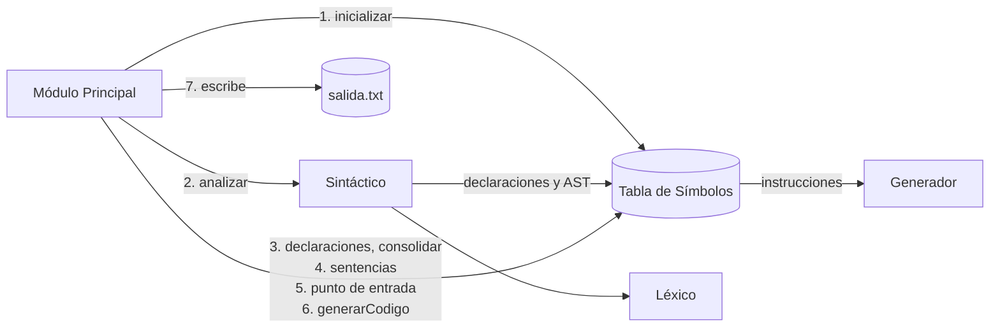

# Arquitectura de la generación de código

## Qué hace

La Etapa 5 traduce un programa MiniJava correcto a **CeIASM**, el lenguaje ensamblador de la
**CeIVM**, una máquina virtual de pila de la cátedra (Apunte CeIVM §1-§2). El resultado es un
archivo de texto que la CeIVM ensambla, carga y ejecuta, y que hace lo que dice el fuente (Pautas
Etapa 5, slides 23-25).

## El flujo de una compilación

Es el de las Pautas Etapa 5, slides 14-24:

1. Hasta el chequeo de sentencias, todo es igual que en la Etapa 4. Mientras tanto, el análisis
   semántico deja fijados los desplazamientos (Clase 16, slides 5 y 36) y anotada en cada nodo la
   entidad que resolvió (slide 17).
2. `TablaDeSimbolos.chequearPuntoDeEntrada()` busca el `static void main()`
   ([`decisiones-de-deteccion-de-errores.md`](decisiones-de-deteccion-de-errores.md)).
3. `TablaDeSimbolos.generarCodigo(Generador)` recorre la tabla y los AST y emite el programa.
4. El Módulo Principal escribe el texto en el archivo de salida, e imprime `Compilacion Exitosa` y
   `[SinErrores]`. Si hubo un error en cualquier paso, lo reporta como siempre y **no** escribe el
   archivo.

`Generador` es la función `Gen` de la Clase 16, slide 7: agrega una instrucción a la secuencia. Se
crea uno por compilación y viaja por parámetro, así que la tabla sigue siendo el único estado
estático del compilador.

## El programa generado

En el orden en que aparece en el archivo (Apunte §15 y §16):

1. **El arranque**: `PUSH simple_heap_init`, `CALL`, `PUSH <main>`, `CALL`, `HALT`.
2. **Las rutinas de soporte**, escritas a mano en `RutinasDeSoporte`: las del heap, crear arreglos
   de una y de varias dimensiones, calcular la dirección de una componente, y los mensajes de los
   errores de ejecución.
3. **Cada clase**, en el orden del fuente: su tabla virtual en `.DATA` y el código de cada unidad
   que declara, en `.CODE`. Las predefinidas `Object`, `String` y `System` también: sus métodos
   tienen el código del Apunte §14.

Las interfaces no generan nada: no tienen cuerpos ni se instancian.

## Las estructuras en ejecución

Todas son las del Apunte.

| Estructura | Forma | Dónde |
|---|---|---|
| Registro de activación | resultado, parámetros, `this`, dirección de retorno, enlace dinámico, locales | `.stack` (§8, §10) |
| CIR (un objeto) | `[VT, atributos…]`: los heredados primero | `.heap` (§9, §11) |
| VT (tabla virtual) | `DW` con la etiqueta de cada método de instancia | `.data` (§9, §16) |
| Arreglo | `[VT de Object, longitud, componentes…]`, la referencia apunta a la VT | `.heap` (§12) |
| String | `[VT de String, longitud, caracteres…, 0]` | `.heap` (§13) |

### Los desplazamientos

| Qué | Valor | Lo calcula |
|---|---|---|
| Atributo | 1, 2, …: el 0 del CIR es la VT | `Clase.offsetDeAtributo`, sobre la tabla consolidada |
| Método de instancia | su índice en la VT; `toString` es el 0 | la disposición de la VT, al consolidar |
| Parámetro i (desde 1) de n | estática `n+3-i`; de instancia `n+4-i` | `Unidad.offsetDeParametro` |
| `this` | 3 | — |
| Resultado | estática `n+3`; de instancia `n+4` | `Unidad.offsetDeRetorno` |
| Local | 0, −1, −2, … según las locales vivas al declararla | `Contexto.declararLocal`, en el chequeo |

**La disposición de la VT** (Apunte §9 y §9.1) se arma al consolidar, después del ancestro:

- `Object`: `[toString]`.
- Una clase: la VT de su padre, después la de la interfaz que implementa, después sus métodos de
  instancia nuevos, en el orden del fuente. Una redefinición reusa la entrada heredada y un
  estático no ocupa ninguna.
- Una interfaz: `[toString]`, la de la interfaz que extiende, sus métodos nuevos.

Así un método tiene el mismo desplazamiento en toda la jerarquía, y una interfaz es un prefijo de
la VT de cualquier clase que la implemente: una llamada por interfaz se despacha igual que una por
clase. Como una clase que implementa una interfaz no extiende otra clase (documento §4), la
interfaz y el padre nunca compiten por las mismas entradas.

## Qué genera cada nodo

Las secuencias son las del Apunte y la Clase 16.

| Nodo | Código |
|---|---|
| Literal | `PUSH` del valor: `true` 1, `false` y `null` 0, un `char` su código. Un String aloja `n+3` celdas y carga la VT, la longitud y los caracteres. |
| Binario | izquierda, derecha, la instrucción (`ADD`, `SUB`, `MUL`, `DIV`, `MOD`, `EQ`, `NE`, `LT`, `GT`, `LE`, `GE`). `&&` y `\|\|`: `DUP`, `BF` o `BT` al final, `POP` y la derecha (cortocircuito, documento §11.2). |
| Unario | `NOT` o `NEG`; el `+` no genera nada. |
| Variable | local o parámetro: `LOAD`; atributo: `LOAD 3` y `LOADREF`. |
| Acceso a atributo | el receptor y `LOADREF`; `length` es `LOADREF 1`. |
| Acceso a arreglo | `RMEM 1`, el arreglo, el índice y la rutina `componente`, que controla el rango y deja `arreglo+indice`; después `LOADREF 2`. |
| Asignación | la derecha, `DUP`, y el destino: `STORE`, o la referencia, `SWAP` y `STOREREF`. Deja el valor asignado. |
| Llamada estática | `PUSH 0` si devuelve algo, los argumentos, `PUSH <etiqueta>`, `CALL`. Con un receptor, el receptor se evalúa y se descarta antes. |
| Llamada dinámica | el receptor (`LOAD 3` si no hay), `PUSH 0` y `SWAP` si devuelve algo, cada argumento y `SWAP`, `DUP`, `LOADREF 0`, `LOADREF <offset>`, `CALL`. |
| `new C(...)` | `RMEM 1`, `PUSH <tamaño>`, `simple_malloc`, `DUP`, `PUSH vt@C`, `STOREREF 0`, `DUP`, cada argumento y `SWAP`, `PUSH <constructor>`, `CALL`. |
| `new T[e1]…[en]` | una dimensión: el tamaño y la rutina `nuevo_arreglo`. Varias: un arreglo con los tamaños y la rutina recursiva `nuevo_arreglo_multi`. |
| Sentencia-expresión | la expresión, y `POP` si deja un valor. |
| `var` | el inicializador, que queda en la celda de la local. |
| Bloque | sus sentencias y `FMEM` de sus locales. |
| `if`, `while` | `BF` y `JUMP` con etiquetas nuevas (Apunte §5). |
| `return` | el valor a la celda del resultado, `FMEM` de todas las locales vivas, y el fin de la unidad. |
| Unidad | `LOADFP`, `LOADSP`, `STOREFP`, el cuerpo, y el fin: un constructor copia `this` a su resultado; después `STOREFP` y `RET` con los parámetros y `this`. |

## Las etiquetas

CeIASM no distingue mayúsculas y sólo admite letras ASCII, dígitos, `_`, `$` y `@` (Apunte §2). Un
identificador de MiniJava distingue mayúsculas y admite cualquier letra. Por eso `Etiquetas`
codifica cada nombre: lo que no es una minúscula ASCII, un dígito o `_` va como `$hex$`. `Aa` es
`$41$a`, y no choca con `AA`. Las partes se separan con `@`, que no aparece en ningún
identificador:

| Etiqueta | Ejemplo |
|---|---|
| `metodo@<clase>@<nombre>@<aridad>` | `metodo@$41$a@mostrar@1` |
| `constructor@<clase>@<aridad>` | `constructor@$41$a@0` |
| `vt@<clase>` | `vt@$41$a` |
| `<rutina>@runtime` | `nuevo_arreglo@runtime` |
| `<prefijo>@<n>` | `fin_if@3`, `while@4` |

La etiqueta de un método lleva la clase que lo **declara**: un heredado tiene el código una sola
vez, y la VT de cada descendiente apunta ahí.
