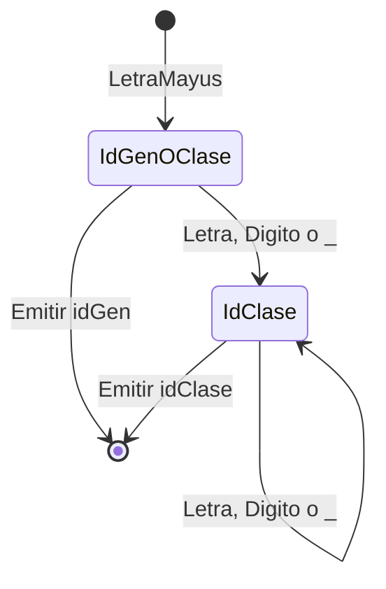
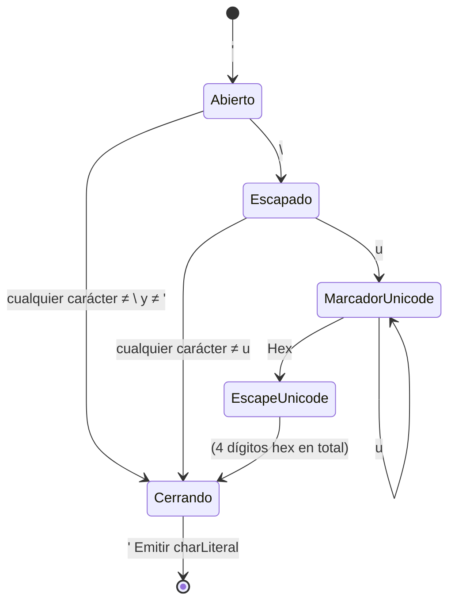
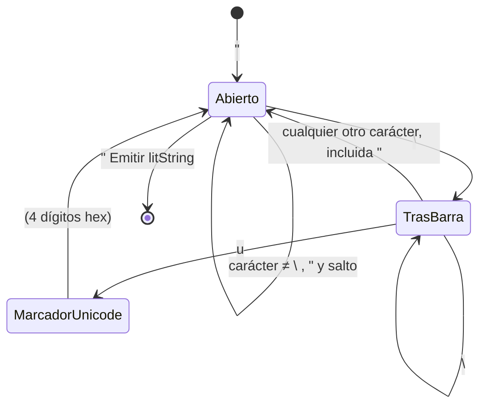
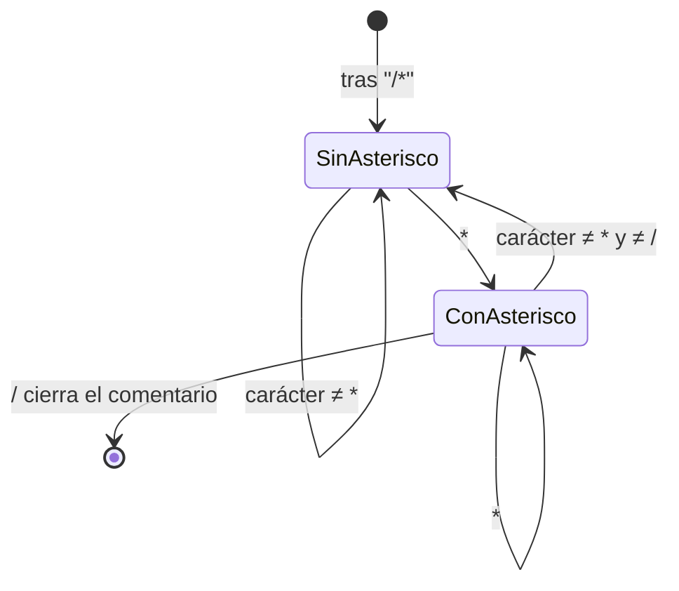
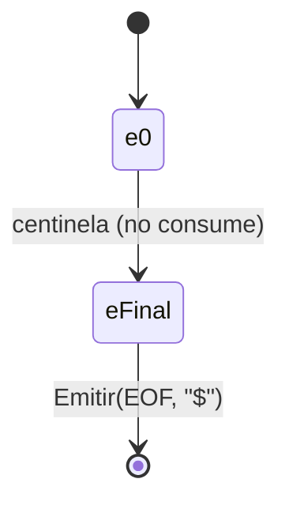

# Especificación léxica formal

Documento autocontenido: la expresión regular exacta de **todos** los tokens de MiniJava, sin omitir
ninguno, con sus autómatas y con lo que queda deliberadamente afuera del lenguaje.

Notación usada en todo el documento:

```text
Digito     = [0-9]
LetraMayus = [A-Z]
LetraMin   = [a-z]
Letra      = LetraMayus | LetraMin
Hex        = [0-9a-fA-F]
```

Un apunte sobre "letra" y "dígito": el proyecto los reconoce con `Character.isLetter` y
`Character.isDigit` de Java, que abarcan más que el ASCII. Las consecuencias de esa elección —y por
qué se tomó— están en [`decisiones.md`](decisiones-de-logica.md) §7.

## 1. Los 56 tokens, de un vistazo

> Los 56 son los que define «Aspectos Léxicos de MiniJava», o sea el alcance de la Etapa 1. La
> Etapa 2 agrega tres que no figuran ahí y que existen porque los necesitan sus logros —`for`,
> `private` y `?`—. Este documento describe el vocabulario de la Etapa 1; el de los tres nuevos
> está en
> [`../sintactico/arquitectura-del-analizador-sintactico.md`](../sintactico/arquitectura-del-analizador-sintactico.md).

| Familia | Cantidad | Tokens |
|---|---|---|
| Palabras clave | 21 | `pr_class`, `pr_extends`, `pr_interface`, `pr_implements`, `pr_static`, `pr_boolean`, `pr_char`, `pr_int`, `pr_void`, `pr_public`, `pr_if`, `pr_else`, `pr_while`, `pr_return`, `pr_var`, `pr_this`, `pr_new`, `pr_null`, `pr_true`, `pr_false`, `pr_float` |
| Identificadores | 3 | `idClase`, `idGen`, `idMV` |
| Literales | 4 | `intLiteral`, `charLiteral`, `litString`, `floatLiteral` |
| Puntuación | 10 | `parenA`, `parenC`, `llaveA`, `llaveC`, `corcheteA`, `corcheteC`, `puntoYComa`, `coma`, `punto`, `dosPuntos` |
| Operadores | 17 | `op_mayor`, `op_menor`, `op_negacion`, `op_asignacion`, `op_igual`, `op_mayorIgual`, `op_menorIgual`, `op_distinto`, `op_and`, `op_or`, `op_modulo`, `op+`, `op-`, `op_mult`, `op_div`, `op_incremento`, `op_decremento` |
| Fin de archivo | 1 | `EOF` |

Los nombres de la columna derecha son literales: son exactamente los que se imprimen en la salida,
porque el formato que fija la cátedra es `(NombreToken,Lexema,NroLinea)`.

## 2. Identificadores

| Token | Expresión regular | Ejemplos | Contraejemplos |
|---|---|---|---|
| `idGen` | `LetraMayus` | `A`, `T` | `AB` (es `idClase`) |
| `idClase` | `LetraMayus (Letra \| Digito \| _)+` | `Alpha`, `A1`, `Mi_Clase` | `A` (es `idGen`) |
| `idMV` | `LetraMin (Letra \| Digito \| _)*` | `v1`, `x`, `mi_metodo` | `_x` (empieza con guion bajo) |

`idGen` (el parámetro de tipo genérico, la `T` de `List<T>`) y `idClase` comparten el primer
carácter, así que se distinguen por longitud: **una** mayúscula sola es `idGen`; una mayúscula
seguida de al menos un carácter más es `idClase`. El autómata lo resuelve con un estado intermedio,
`EstadoIdGenOClase`, que es terminal —si el token termina ahí, es `idGen`— y que transiciona a
`EstadoIdClase` en cuanto aparece un carácter más.



Un identificador que empieza con minúscula es siempre `idMV`, **salvo** que su lexema completo
coincida con una de las 21 palabras clave: en ese caso se emite la palabra clave. Ese chequeo es una
consulta a una tabla, no un autómata — ver §7.

## 3. Literales

### 3.1. `intLiteral`

```text
intLiteral = Digito Digito? Digito? Digito? Digito? Digito? Digito? Digito? Digito?
```

Uno a nueve dígitos. Equivale a la notación de repetición acotada `Digito{1,9}`.

**El límite se valida después, no durante.** El estado consume la corrida **completa** de dígitos y
recién al terminar comprueba que no haya más de nueve. La razón es que si el carácter siguiente a la
corrida es un `.` o una `e`/`E`, la corrida continúa hacia un `floatLiteral` — que **no** tiene ese
límite —, y cortar en el noveno dígito rompería esa continuación. Por eso `1234567890.5` es un float
válido de diez dígitos en la parte entera, mientras que `1234567890` solo es un error.

### 3.2. `charLiteral`

```text
charLiteral = ' X '  |  ' \ Y '  |  ' \ U '

X = cualquier carácter salvo \ y '
Y = cualquier carácter salvo u
U = escape Unicode (ver §3.5)
```

La cadena vacía (`''`) **no** está en ninguna alternativa: es un error. Y `'\q'` **sí** es válido,
con valor `q` — es una permisividad explícita de la cátedra, más laxa que Java.

**Qué significa exactamente "un carácter".** `X` e `Y` no están restringidos a ASCII: valen las
letras acentuadas, la eñe y los alfabetos no latinos igual que las de ASCII. El límite real es que
`X` e `Y` son **una unidad de código UTF-16**, porque la interfaz `SourceManager` que fija la cátedra
declara `char getNextChar()` y un `char` de Java son 16 bits.

| Fuente | Code points | Unidades UTF-16 | Resultado |
|---|---|---|---|
| `'⭐'` | `U+2B50` | 1 | `charLiteral` válido |
| `'ñ'`, `'中'`, `'Ω'` | uno cada uno | 1 | `charLiteral` válido |
| `'🌟'` | `U+1F31F` | 2 (par subrogado) | error: *mal formado* |
| `'⭐️'` | `U+2B50 U+FE0F` | 2 | error: *mal formado* |

Todo lo que vive en el BMP (`U+0000`–`U+FFFF`) ocupa una unidad y entra sin problema. Lo que está
fuera del BMP se codifica como par subrogado —dos unidades— y no entra. El último caso requiere
especial atención: `'⭐️'` es la estrella **más** un selector de variación `U+FE0F`, combinación que
puede ser incorporada por distintos métodos de entrada y que en pantalla se ve idéntica a `'⭐'`.

**Esto no es una divergencia con Java, sino una coincidencia.** `javac` sobre `char c = '🌟';` responde
`error: character literal contains more than one UTF-16 code unit` — nombra literalmente la misma
limitación, y por la misma razón. Fijado por `resources/lexico/sinErrores/charConSimbolosNoAscii.java` y
`resources/lexico/conErrores/charConEmojiFueraDelBmp.java`.



Los tres caminos que **no** llegan a `[*]` son los tres errores del charLiteral: `''` (char vacío),
un fin de línea o de archivo antes de cerrar (`sin cerrar`), y un carácter cualquiera donde debía ir
la comilla de cierre (`mal formado`).

### 3.3. `litString`

```text
litString = " ( Z | \ C )* "     con la " de cierre NO antecedida por \

Z = cualquier carácter salvo \, " y salto de línea
C = cualquier carácter salvo salto de línea  (incluye \ y ")
U = escape Unicode (ver §3.5), que se superpone a la regla anterior
```

**El `litString` se especifica distinto que el `charLiteral`, y por eso su ER tiene otra forma.**
`Aspectos Lexicos MiniJava 2026.pdf` §2.3.2 le da al `charLiteral` una **producción con dos
alternativas** (`'x'` y `'\y'`, con `x` e `y` independientes): es una regla de **apareamiento**, la
barra y el carácter siguiente forman una unidad. §2.3.3, en cambio, no da ninguna producción para el
string; da una regla **posicional**:

> *"es posible que en la secuencia de caracteres aparezca una comilla doble siempre y cuando se la
> anteceda por el caracter `\`. Por esto último la comilla doble que marca el final de un string
> correcto nunca estará antecedida por ese caracter."*

O sea: un lookbehind de un carácter sobre el texto crudo. **No existe un conjunto de escapes
válidos** dentro de un `litString` — `"hola \q"` es un string común y corriente, con una barra y una
`q` como dos caracteres cualesquiera.

De que la regla sea posicional y no de apareamiento se desprenden las siguientes consecuencias:

| Fuente | Resultado | Por qué |
|---|---|---|
| `"hola \q"` | `litString` válido | la `"` de cierre no está antecedida por `\` |
| `"di \"hola\" chau"` | **un solo** `litString` | las dos `"` internas están antecedidas por `\` |
| `"a\\"` | `litString sin cerrar` | la `"` final está antecedida por `\`, así que no cierra |
| `"a\\\""` | `litString` válido | la primera `"` no cierra, la segunda sí |
| `"barra \\ al medio"` | `litString` válido | la barra sólo importa pegada a la comilla de cierre |

La tercera fila es el único punto donde MiniJava **diverge de Java**, donde `"a\\"` es la barra
invertida: acá una barra no "cancela" a la anterior, porque la regla no habla de pares sino de qué
carácter antecede a la comilla. Está en [`decisiones.md`](decisiones-de-logica.md) §7.

Un `litString` **no puede contener un salto de línea real**: si aparece uno antes de la comilla de
cierre, el literal quedó sin cerrar y es error.

El **escape Unicode** se superpone a esa regla y es lo único que se valida dentro del literal (es un
logro, §3.5). Un `\u` sin sus cuatro dígitos hexadecimales aborta el literal: se reporta y se
descarta lo que queda **hasta la comilla de cierre**, sin emitir token. El detalle está en
[`manejo-de-errores.md`](../compartido/manejo-de-errores.md) §2.1.

El autómata implementa el lookbehind con dos estados, que es exactamente el bit de memoria que la
regla necesita:



### 3.4. `floatLiteral`

```text
floatLiteral = Digito+ . Digito* Exponente? Sufijo?
             | Digito+ Exponente Sufijo?
             | Digito+ Sufijo

Exponente = (e|E) (+|-)? Digito+
Sufijo    = f | F | d | D
```

Igual que los floats de Java, con **una** salvedad que fija la consigna: siempre empiezan con un
dígito. Por eso `.5` no es un float en MiniJava — es el token `punto` seguido de `intLiteral(5)`.

Ninguna de las tres partes tiene límite de dígitos, a diferencia del `intLiteral`. El desarrollo de
por qué, con la verificación contra `javac`, está en [`decisiones.md`](decisiones-de-logica.md) §3.3.

Dos casos que valen como error, sin retroceso: `1e` y `1.5e+`, un exponente anunciado y sin dígitos.
No hay backtracking a un token más corto — una vez consumida la `e` como inicio de exponente, el
literal está comprometido.

### 3.5. El escape Unicode

```text
U = \ u+ Hex Hex Hex Hex
```

El marcador `u` se repite **una o más veces**: `\u0041`, `\uu0041` y `\uuuu0041` son todos válidos y
equivalentes. Es una regla heredada de Java (JLS §3.3), verificada contra la especificación. Existe
porque el pre-procesador de escapes de Java necesita poder representar un
`\u` literal sin re-traducirlo.

`EstadoMarcadorUnicode` consume la corrida de `u`; `EstadoEscapeUnicode` exige exactamente cuatro
dígitos hexadecimales después de la última. Ambos estados saben **a qué estado volver** al terminar,
porque el mismo escape sirve dentro de un `charLiteral` y dentro de un `litString`.

## 4. Puntuación

| Token | ER | Token | ER | Token | ER | Token | ER |
|---|---|---|---|---|---|---|---|
| `parenA` | `(` | `parenC` | `)` | `llaveA` | `{` | `llaveC` | `}` |
| `corcheteA` | `[` | `corcheteC` | `]` | `puntoYComa` | `;` | `coma` | `,` |
| `punto` | `.` | `dosPuntos` | `:` | | | | |

Los diez se reconocen con una tabla `Map<Character, TipoDeToken>` consultada desde el estado inicial:
son tokens de un solo carácter, sin lookahead, y no justifican un estado propio.

## 5. Operadores

| Token | ER | Token | ER |
|---|---|---|---|
| `op_mayor` | `>` | `op_mayorIgual` | `>=` |
| `op_menor` | `<` | `op_menorIgual` | `<=` |
| `op_negacion` | `!` | `op_distinto` | `!=` |
| `op_asignacion` | `=` | `op_igual` | `==` |
| `op+` | `+` | `op_incremento` | `++` |
| `op-` | `-` | `op_decremento` | `--` |
| `op_mult` | `*` | `op_div` | `/` |
| `op_modulo` | `%` | | |
| `op_and` | `&&` | `op_or` | `\|\|` |

Se dividen en tres grupos por su comportamiento en el autómata:

**Con sufijo opcional** (`>`, `<`, `!`, `=`, `+`, `-`): el primer carácter ya forma un token válido,
y el segundo lo extiende. El estado que los reconoce es **terminal**: si el sufijo no viene, emite el
token corto sin consumir el carácter que miró. Los seis los cubre un único estado parametrizado.

**Con segundo carácter obligatorio** (`&&`, `||`): `&` y `|` sueltos **no** son tokens válidos — no
están en la lista de operadores de la cátedra. El estado que los reconoce es **no terminal**: si el
segundo carácter no viene, es un error léxico.

**De un solo carácter** (`*`, `%`, y `/` cuando no abre un comentario): se emiten directamente.

## 6. Lo que no es un token

### 6.1. Separadores

Espacio, tabulador y salto de línea. Se descartan sin agregarse a ningún lexema.

El form feed (`\f`) y el tabulador vertical (`\v`) **no** son separadores en MiniJava, aunque sí lo
son en Java: no están en la lista de la cátedra. Producen error léxico.

### 6.2. Comentarios

De línea (`// ... hasta el fin de línea`) y multilínea (`/* ... */`). Se descartan por completo: no
producen token y su contenido no forma parte de ningún lexema.

Un comentario multilínea **sin cerrar** es un error léxico, y se reporta con el lexema `/*` y la
línea de **apertura** del comentario, no la del fin de archivo donde se descubrió.

La ER del comentario multilínea es exacta y estándar — la misma que usan `lex`/`flex` para los
comentarios de C:

```text
/\*  ( [^*] | \*+ [^*/] )*  \*+  /
```

En palabras: tras el `/*`, el contenido es cualquier cantidad de (un carácter que no sea `*`) o (uno
o más `*` seguidos de un carácter que no sea ni `*` ni `/`), y cierra con uno o más `*` seguidos de
`/`. El autómata equivalente tiene exactamente dos estados relevantes dentro del comentario:



## 7. El autómata delimita el lexema, la tabla lo nombra

Los 56 tokens se parten en dos grupos según de dónde sale su lexema:

| Grupo | Cuántos | Cuáles |
|---|---|---|
| **Lexema fijo** — el tipo y el lexema se determinan mutuamente | 49 | las 21 palabras clave, los 10 símbolos de puntuación, los 17 operadores y `EOF` |
| **Lexema variable** — se lee del fuente | 7 | `idClase`, `idGen`, `idMV`, `intLiteral`, `charLiteral`, `litString`, `floatLiteral` |

Los 49 del primer grupo no necesitan un estado que lleve su tipo encima: alcanza con que el autómata
delimite el lexema y con consultar una tabla. `TablaDeLexemas` es esa tabla, y expone las dos
direcciones — lexema → tipo, para emitir; tipo → lexema, para el `$` del `EOF`, que no se lee del
fuente.

**Lo único que la tabla no puede resolver es el *maximal munch*.** No sabe si un `>` es `op_mayor` o
el principio de un `op_mayorIgual`: eso lo decide el autómata mirando el carácter siguiente, y recién
cuando terminó de consumir consulta la tabla. El reparto es nítido: **el autómata delimita, la tabla
nombra.**

Es exactamente la técnica que la cátedra recomienda para las palabras clave (Clase 02, slides 62-63),
generalizada a los 49. Para las 21 reservadas el mecanismo es el mismo de siempre: se reconocen como
un `idMV` común y, antes de emitir, se consulta la tabla; si el lexema coincide, se emite la palabra
clave. Modelarlas con estados dedicados exigiría casi un estado por letra de cada palabra, fusionados
con los estados de identificador — decenas de estados frágiles para algo que una tabla resuelve en
tiempo constante.

**`float` está en la lista aunque no figure en ningún PDF de la cátedra**: se agrega por confirmación
directa del profesor. **`double` no está**: MiniJava tiene un único tipo de punto flotante, pero eso
no convierte a la palabra `double` en reservada — sigue siendo un `idMV` común. Ver
[`decisiones.md`](decisiones-de-logica.md) §3.1.

## 8. El token `EOF`

Es un token más, con lexema `$` — literal de Aspectos Léxicos §2.5: *"El End of File es un token mas,
su y lexema es `$`"*. Su ER es trivial: un solo símbolo sobre la condición de fin de contenido.

**El `$` y el centinela son dos cosas distintas**, y conviene separarlas porque el nombre las
confunde:

- El **centinela** es `SourceManager.END_OF_FILE = (char) 26`, valor que fija la interfaz provista.
  Es el valor que `getNextChar()` devuelve cuando ya no queda contenido.
- El **`$`** es el lexema que se imprime para el token `EOF`. No se lee del fuente y no tiene ninguna
  relación con el centinela. Un `$` **escrito en el fuente** es un símbolo inválido y produce un error
  léxico, por §3.3 (*"cualquier otra entrada que no comforme con las reglas anteriormente presentadas
  debe generar un error"*).

De ahí una decisión del manejador de archivo: **el fin de archivo son dos condiciones unidas por un
`AND`, no una sola.** El centinela sigue siendo la señal, pero recibirlo es condición *necesaria y no
suficiente*, porque `0x1A` es un byte legítimo dentro de un archivo —en un binario aparece a menudo—.
La segunda condición la aporta `estaEnFinDeArchivo()`, que confirma que la posición de lectura se
pasó del contenido:

```text
fin de archivo  ⇔  llegó el centinela  ∧  la posición confirma que se acabó el contenido
```

Si llega el centinela pero la posición dice que todavía queda archivo, entonces **no era** un fin de
archivo: es un carácter del fuente, y se reporta como símbolo inválido. Sin esa segunda condición, un
`0x1A` embebido cortaría el análisis ahí en silencio, informando `[SinErrores]` sobre un fuente que
nunca se terminó de leer.

En el código se testea un solo conjunto porque el segundo implica al primero: el manejador devuelve
el centinela únicamente en la misma rama en que prende la bandera. El `AND` queda implícito. El
detalle está en [`manejador-de-archivo.md`](../compartido/manejador-de-archivo-eficiente.md) §2.4.



Lo único distinto respecto de cualquier otro token es un detalle del **driver**, no del lenguaje: esa
transición **no avanza la posición de lectura**. No tendría sentido "consumir" el fin de archivo, y
además el Módulo Principal podría pedir otro token después.

**La línea del EOF** es `cantidad de saltos de línea consumidos + 1`. Vale la pena enunciarla porque
es la regla que fija el resultado en los tres casos de ejemplo de la cátedra, incluido el archivo que
no termina en salto de línea — ver [`manejador-de-archivo.md`](../compartido/manejador-de-archivo-eficiente.md) §2.

## 9. Sobre la regularidad de los tres casos "especiales"

El EOF, el comentario multilínea y el límite de 9 dígitos parecen, a primera vista, escaparse de lo
que una expresión regular puede describir. Los tres son regulares, y vale la pena mostrar por qué:

- **El EOF** es una ER de un solo símbolo (§8). Lo especial es del driver, no del lenguaje.
- **El comentario multilínea** tiene la ER exacta de §6.2, que no es una aproximación.
- **El límite de 9 dígitos** es trivialmente regular: toda repetición **acotada** lo es. La ER es una
  cadena lineal de nueve estados terminales sin bucle, o equivalentemente `Digito{1,9}` — lo que el
  profesor describió como "una estrella de Kleene de aridad 1-9". Ojo con la diferencia: `Digito*`
  (Kleene **sin** cota) sería incorrecto acá, porque el límite de 9 es justamente lo que se está
  modelando.

La implementación usa, para ese último caso, una variante observacionalmente equivalente pero más
simple: un único estado con bucle que consume toda la corrida y valida el largo al final. Ver §3.1
para por qué esa forma, además, es la única que no rompe la continuación hacia un float.

## 10. Ver también

- [`arquitectura.md`](arquitectura-del-analizador-lexico.md) — dónde encaja el léxico en el conjunto.
- [`patron-state.md`](patron-state-metodo-por-estado.md) — cómo cada uno de estos autómatas se convierte en código.
- [`decisiones.md`](decisiones-de-logica.md) — de dónde sale cada regla de este documento.
- [`manejo-de-errores.md`](../compartido/manejo-de-errores.md) — qué pasa cuando la entrada no matchea ninguna ER.

---

# Reglas operativas para quien implementa

Todo lo anterior explica **qué hace** el compilador y **por qué**. Lo que sigue son las **reglas
de trabajo** correspondientes: lo que hay que respetar al escribir o modificar código de esta
parte. Antes vivía en un archivo aparte; se unificó acá para que el tema tenga un solo lugar.

### Tabla

| Elemento | Regla | Token(s) |
|---|---|---|
| Palabras clave (21) | lookup tras armar un identificador (Clase 02, slide 62-63: **no** se modelan como AF propio, para evitar fusionar decenas de estados con los de identificador) | `pr_class`, `pr_extends`, `pr_interface`, `pr_implements`, `pr_static`, `pr_boolean`, `pr_char`, `pr_int`, `pr_void`, `pr_public`, `pr_if`, `pr_else`, `pr_while`, `pr_return`, `pr_var`, `pr_this`, `pr_new`, `pr_null`, `pr_true`, `pr_false`, `pr_float` |
| idClase / idInterfaz | letra mayúscula + uno o más de (letra, dígito, `_`) — mínimo 2 caracteres | `idClase` |
| idGen (parám. genérico) | una única letra mayúscula | `idGen` |
| idMV (método/variable) | letra minúscula + cero o más de (letra, dígito, `_`) | `idMV` |
| Entero | uno a nueve dígitos (se valida el límite de 9 tras consumir la corrida completa) | `intLiteral` |
| Char | `'x'` (x ≠ `\`, `'`) o `'\x'` (x cualquiera — permisividad explícita de la cátedra) | `charLiteral` |
| String | `"..."` con `\` escapando el carácter siguiente, sin saltos de línea; escapes restringidos al conjunto válido de Java (ver abajo) | `litString` |
| Float (logro) | igual que Java, **siempre** empieza con dígito | `floatLiteral` |
| Puntuación | `( ) { } [ ] ; , . :` | `parenA`/`parenC`, `llaveA`/`llaveC`, `corcheteA`/`corcheteC`, `puntoYComa`, `coma`, `punto`, `dosPuntos` |
| Operadores | `> < ! = == >= <= != && \|\| % + - * / ++ --` | `op_mayor`, `op_menor`, `op_negacion`, `op_asignacion`, `op_igual`, `op_mayorIgual`, `op_menorIgual`, `op_distinto`, `op_and`, `op_or`, `op_modulo`, `op+`, `op-`, `op_mult`, `op_div`, `op_incremento`, `op_decremento` |
| EOF | fin de archivo, no consume carácter (Clase 02, estado especial `e5`) | `EOF`, lexema `$` |

### Palabras reservadas fuera de los PDFs: `float` sí, `double` no

**`float` como palabra reservada**: no figura en ningún PDF de la cátedra (se buscó explícitamente);
se agrega por confirmación directa del profesor en una consulta puntual del usuario. Antes de este
cambio no era palabra clave — un identificador `float` habría tokenizado como `idMV`; ahora tokeniza
como `pr_float` y no puede usarse como nombre de variable/método/clase.

**`double` NO es palabra clave.** Primera versión de esta decisión (revertida): se había agregado
`double` como palabra reservada mapeada al mismo `TipoDeToken.PR_FLOAT` que `float`, interpretando
"tratemos float y double como lo mismo" como "ambas palabras son reservadas". El usuario corrigió esa
lectura: lo que el profesor quiso decir es que MiniJava sólo tiene **un** tipo de dato de punto
flotante (`float`), no que la palabra `double` deba existir como reservada. `double` sigue siendo un
identificador común (`idMV`) — sólo los **sufijos** `f`/`F`/`d`/`D` del literal float (ver abajo,
heredados tal cual de Java) son donde el concepto "double" realmente aparece en la sintaxis de
MiniJava.

### `floatLiteral` en detalle

```text
floatLiteral = Digito+ . Digito* Exponente? Sufijo?
             | Digito+ Exponente Sufijo?
             | Digito+ Sufijo

Exponente = (e|E) (+|-)? Digito+
Sufijo    = f|F|d|D
```

Pautas Etapa 1 dice literalmente: *"Estos deben tener la misma estructura que los floats de Java, con
la salvedad que siempre deben comenzar con un dígito."*

**Los floats no tienen límite de dígitos, ni por la cátedra ni por Java.** El límite de 9 dígitos es
exclusivo de `intLiteral`: la ER del `floatLiteral` usa `Digito+` sin cota en las tres partes (entera,
fraccionaria y exponente), y la frase de Pautas habla de **estructura**, no de rango.

Java tampoco acota la cantidad de dígitos — lo verificado con `javac`:

| literal | `javac` |
|---|---|
| `1.0000…0001f` (60+ dígitos) | **compila** |
| `123456789012345678901234567890.0f` (30 dígitos) | **compila** |
| `3.4e38f` / `3.5e38f` | compila / `floating-point number too large` |
| `1e-45f` / `1e-46f` | compila / `floating-point number too small` |

Lo que Java rechaza es un literal **no nulo que se redondee a infinito o a cero**: un chequeo de
**valor**, no léxico (lo hace al convertir el literal, no al tokenizarlo). **MiniJava no lo hace**, y
la decisión es deliberada: la cátedra pidió la misma *estructura*, y un chequeo de rango es
semántico, no de Etapa 1. Fijado en `resources/lexico/sinErrores/floatFueraDelRangoDeJava.java`.

**Asimetría a tener presente**: el chequeo de 9 dígitos de `EstadoEntero` corre **sólo si la corrida
de dígitos no continúa hacia un float**, así que `1234567890.5` es un `floatLiteral` válido con diez
dígitos en la parte entera, mientras que `1234567890` solo es un error. Y el límite de MiniJava es de
**dígitos** mientras que el de Java es de **valor**: `0000000001` (diez dígitos, valor 1) es error en
MiniJava y válido en Java. Toda esta gramática (incluidos los sufijos
`f`/`F`/`d`/`D`) se deriva de esa frase vía el protocolo de [`investigacion.md`](../proyecto/protocolo-de-investigacion.md),
ya que `Aspectos Lexicos MiniJava 2026.pdf` no menciona floats en absoluto (no está entre sus "cinco
tipos de literales" — floats es puramente un logro de Pautas, no parte de la especificación base).

### Tres casos especiales — corrección de una confusión anterior

En un intento previo se afirmó, incorrectamente, que el EOF, el comentario multilínea y el límite de
9 dígitos "no eran expresables" con precisión como ER/AF. Es falso; los tres son perfectamente
regulares, corregido en
[`../documentacion/especificacion-lexica.md`](especificacion-lexica-de-minijava.md):

- El EOF es una ER trivial de un símbolo sobre el carácter centinela (`SourceManager.END_OF_FILE`);
  lo único especial es que esa transición no avanza la lectura (detalle del driver, no del lenguaje).
  **Ojo con la condición de disparo**: recibir el centinela es necesario pero NO suficiente, porque
  `(char) 26` es un byte legítimo dentro de un fuente. El fin de archivo es un AND — centinela Y
  `estaEnFinDeArchivo()`, que confirma por posición—; en el código se testea sólo el segundo porque
  implica al primero (el manejador devuelve el centinela en la misma rama en que prende la bandera).
  Un centinela sin fin de archivo cae en el `throw` final de `EstadoInicial`: símbolo inválido.
- El comentario multilínea tiene una ER exacta y estándar (la misma que usa `lex`/`flex` para
  comentarios de C): `/\*([^*]|\*+[^*/])*\*+/`. No es una aproximación.
- El límite de 9 dígitos es trivialmente regular (toda repetición acotada lo es): una cadena lineal
  de 9 estados terminales sin bucle, o la ER `D D? D? D? D? D? D? D? D?`. Formulación equivalente que
  el profesor confirmó como válida: una estrella de Kleene "de aridad 1-9", es decir `D{1,9}` — la
  notación de repetición acotada que se expande exactamente a la misma cadena de nueve `D?`
  opcionales (no es una estrella de Kleene sin cota; `*` sin límite sería incorrecto acá, precisamente
  porque el límite de 9 es lo que se está modelando).
- El escape Unicode (`\u` + 4 hex dígitos) acepta repetir el marcador `u` una o más veces
  (`\uu0041`, `\uuu0041`, ...), semántica heredada de Java (JLS §3.3, ver
  [`investigacion.md`](../proyecto/protocolo-de-investigacion.md)). La ER real del escape es `\u+[0-9a-fA-F]{4}` (una o más
  `u`), no `\u[0-9a-fA-F]{4}` (una sola).

### Decisiones ambiguas resueltas (documentar también en el informe)

- **`&` y `|` solos son error.** No están en la lista de operadores de `Aspectos Lexicos MiniJava
  2026.pdf` §2.4.2 — sólo `&&` y `||`. Sus estados iniciales son no terminadores.
- **Escapes en `charLiteral`: `'\x'` con `x` arbitrario es válido** — dicho explícitamente en
  `Aspectos Lexicos MiniJava 2026.pdf` §2.3.2. `'\q'` es un `charLiteral` válido con valor `q`.
- **`''` (char vacío) es error.** La ER de la cátedra es `'x'` con `x ≠ \, '` o `'\x'`: la cadena
  vacía no está en ninguna de las dos alternativas. `javac` coincide (`empty character literal`), así
  que no hay ambigüedad por ningún lado. Cubierto por `resources/lexico/conErrores/tresComillasSimples.java`,
  que además ejercita la cascada: la tercera comilla abre un `charLiteral` que nunca cierra.
- **Escapes en `litString`: restringidos al conjunto válido de Java** (JLS §3.10.7, verificado contra
  la especificación — ver [`investigacion.md`](../proyecto/protocolo-de-investigacion.md)): `b s t n f r " ' \` o un dígito
  octal `0`-`7`, más el escape unicode. A diferencia de `charLiteral`, la cátedra **no** dice
  "cualquier carácter" para `litString` (§2.3.3 sólo cita a Java para el caso `\"` específicamente),
  así que acá aplica "ante la duda, como en Java" en vez de la permisividad explícita del char.
  `"a\q"` es un error léxico; `"a\s b"`, `"a\7"`, `"a\""` son válidos.
- **`\` dentro de un string consume el siguiente carácter** (semántica Java estándar) → `"a\\"`
  cierra correctamente. La lectura literal de la consigna ("la comilla final nunca estará antecedida
  por `\`") daría un string sin cerrar en ese caso; se prioriza la regla "ante la duda, como en Java".
- **El lexema reportado es siempre el texto crudo del fuente.** Confirmado por
  `testersLexico/Guia_de_uso_testers.md`: se espera `//#'\n',3` (4 caracteres literales), no el salto
  de línea decodificado. **El valor decodificado todavía no se calcula ni se guarda**: `Token` es hoy
  `record Token(TipoDeToken tipo, String lexema, int linea)`, sin campo de valor. Etapa 1 no lo
  necesita —la salida imprime el lexema crudo, que es lo que exige la cátedra— y se agregará cuando
  una etapa posterior lo requiera. Cuando se agregue, será un campo aparte: **nunca** reemplaza al
  lexema.
- **Límite de 9 dígitos**: se consume la corrida completa de dígitos y recién ahí se valida — así no
  se rompe un float largo (`1234567890.5` es válido, la parte entera sola no debe cortar antes).
- **`1e` / `1.5e` sin dígitos después del exponente → error**, sin backtracking a un token más corto.
- **`/*` sin cerrar → error**, con lexema `/*` y la línea de **apertura** del comentario.
- **`1abc` → dos tokens**: `intLiteral(1)` seguido de `idMV(abc)` (maximal munch estándar, igual que
  el lexer de Java).
- **En un `litString` NO hay conjunto de escapes válidos.** Aspectos Léxicos §2.3.3 no da una
  producción con barra; da una regla **posicional**: *"la comilla doble que marca el final de un
  string correcto nunca estará antecedida por [`\`]"*. Cierra la primera `"` no antecedida por `\`,
  y punto. Consecuencias: `"hola \q"` es válido, `"di \"hola\" chau"` es UN solo litString, y
  **`"a\\"` queda sin cerrar** (una barra no cancela a la anterior; es la única divergencia con Java
  que sale de acá). El autómata lo implementa con dos estados —`EstadoStringAbierto` y
  `EstadoStringTrasBarra`—, que es el bit de memoria del lookbehind.
  **Ojo con la asimetría respecto de `charLiteral`, que es intencional y viene de la forma de cada
  regla**: §2.3.2 sí da una producción con dos alternativas (`'x'` y `'\y'`, variables
  independientes), o sea una regla de **apareamiento**, y por eso `'\\'` y `'\''` son válidos.
- **Un escape unicode mal formado dentro de un `litString` descarta el literal hasta su comilla de
  cierre**, sin emitir token. Es el ÚNICO error de contenido que queda dentro de un litString.
  Criterio fijado por el **profesor**, no por `javac` (que sigue leyendo el literal). En
  `charLiteral` no aplica: no hay contenido de largo arbitrario que descartar, la recuperación es
  estructural. Ver [`manejo-de-errores.md`](../compartido/manejo-de-errores.md).
- **`unicodeHabilitado` gatea sólo el escape `\uXXXX`**, no los caracteres no-ASCII crudos dentro de
  literales: gatear eso exigiría clasificadores ASCII-only en todo el autómata, y el logro se puede
  demostrar igual con el escape.

### Divergencias con Java que quedan fijadas por tests

Ninguna es un descuido: están todas cubiertas por casos de `resources/` a propósito, y hay que
mencionarlas en el informe.

| Caso | Java | MiniJava |
|---|---|---|
| `\uXXXX` fuera de un literal (en un comentario, en un identificador) | se traduce **antes** de tokenizar en todo el archivo (JLS §3.3), así que un `\u12G4` en un comentario no compila | el escape sólo significa algo dentro de un `charLiteral` o un `litString`; en un comentario es texto |
| `"\u0022"` | el escape se traduce primero y la comilla **cierra** el string | no cierra nada: son seis caracteres del lexema |
| Dígitos árabe-índicos (`١٢٣`) | no valen en un literal numérico | `Character.isDigit` los acepta: son un `intLiteral` |
| Dígitos no ASCII en `\uXXXX` | inválidos | `Character.digit(c,16)` los acepta |
| `中` al empezar un identificador | válido | error: no es ni mayúscula ni minúscula, aunque **sí** puede continuar un identificador |
| Form feed y tabulador vertical | son blancos | son errores léxicos |
| BOM al inicio del archivo | se descarta | es un carácter desconocido |
| `3.5e38f`, `1e999` (float fuera de rango) | `floating-point number too large` | `floatLiteral` válido: el rango es un chequeo semántico, no léxico |
| `0000000001` | `intLiteral` válido (el límite es de valor) | error: el límite de MiniJava es de **dígitos** |
| `041` | literal **octal**, vale 33 | `intLiteral` decimal de 3 dígitos |
| `09` | `illegal digit in an octal literal` | `intLiteral` válido de 2 dígitos |
| `0x1F`, `0b1010` | literal hexadecimal / binario | `intLiteral(0)` + `idMV` — la ER de la cátedra es decimal y nada más |
| `1_000` | válido (separadores desde Java 7) | `intLiteral(1)`, error por el `_`, `intLiteral(000)` |
| Un carácter invisible en el mensaje de error | `illegal character: '\u00a0'` — escapado | escapado igual, misma convención |
| Columna a la que apunta el `^` | carácter ofensivo, o inicio de la construcción que falló | mismo criterio, caso por caso (`PosicionDelCaretTest`) |

### Los 8 logros y su estrategia

| Logro | Estrategia |
|---|---|
| Manejador de Archivos Eficiente | **Requisito, no un extra**: ver [`arquitectura.md`](arquitectura-del-analizador-lexico.md) "por qué el manejador de la cátedra está roto". Char a char sobre buffer de bloques, sólo `java.io`. |
| Multi-detección de Errores | recuperación en el Módulo Principal; invariante a testear con property-based: cada recuperación consume ≥1 carácter o llega a EOF (garantiza terminación). |
| Reporte de Error Elegante | además de línea y razón, mostrar la línea completa del fuente y un `^` apuntando a la posición — **y también columna**, decisión del usuario más allá de lo pedido por la cátedra. Dónde apunta el `^` sigue el criterio de `javac`, salvo `charLiteral vacío`, que señala la comilla de cierre: ver [`manejo-de-errores.md`](../compartido/manejo-de-errores.md). |
| Floats I | siempre activo; la forma del literal la gobiernan los estados numéricos. |
| Unicodes | caracteres no-ASCII crudos dentro de literales char/string + escape `\uXXXX` (marcador repetible). |
| Imbatibilidad Léxica | consecuencia de la suite masiva + corpus de `resources/`. |
| Good Job! I | consecuencia de lo anterior. |
| Entrega Anticipada | hito de calendario. |

Los cuatro logros de comportamiento (floats, unicode, reporte elegante, multi-detección) están
**siempre activos**.
