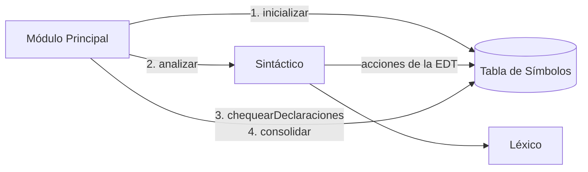
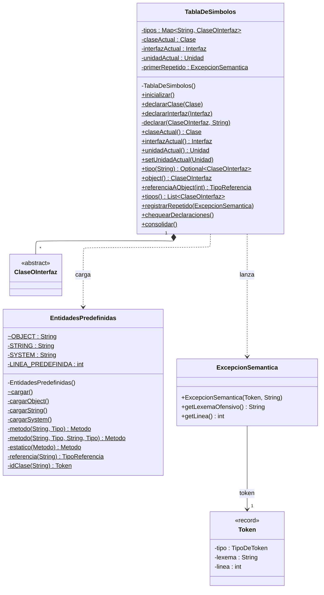
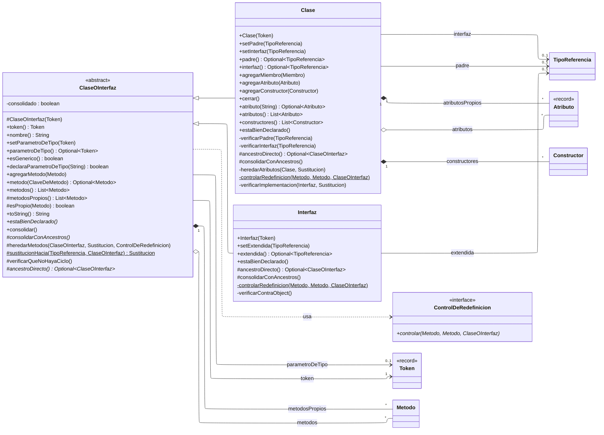
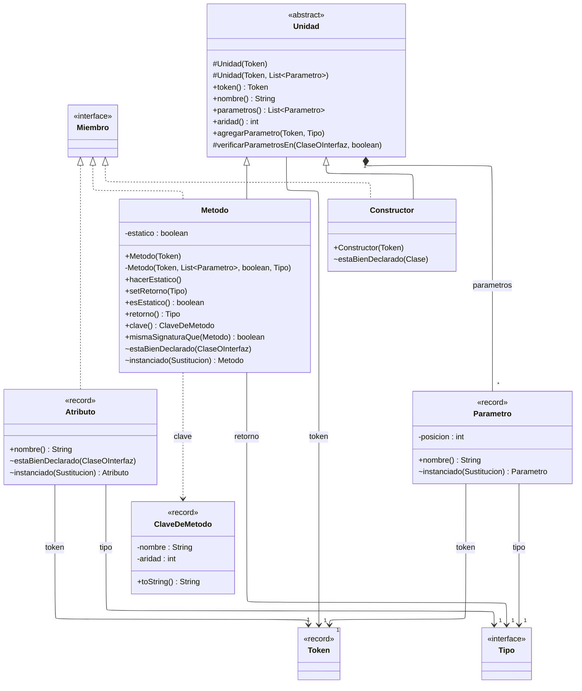
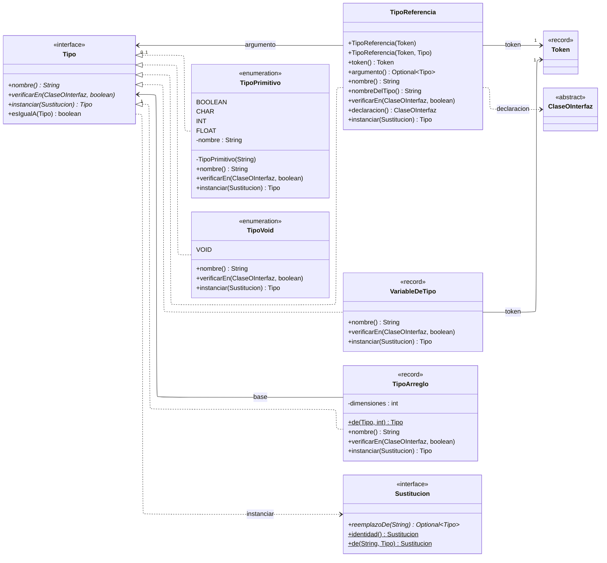

# Arquitectura del analizador semántico

## Qué hace y qué no

El análisis semántico de un lenguaje con tipado estático tiene dos mitades (Clase 6, slide 3). El
**chequeo de declaraciones** controla todo lo que está fuera de un bloque: clases, interfaces,
atributos, encabezados de métodos y constructores, y parámetros. El **chequeo de sentencias**
controla lo que está dentro de los cuerpos. Esta etapa hace sólo la primera mitad. Ningún cuerpo
se mira, y tampoco la expresión que inicializa un atributo.

## El flujo de una compilación

Es el esquema de Pautas Etapa 3, slides 15-25:

1. `ModuloPrincipalSemantico` inicializa la tabla, que queda con `Object`, `String` y `System`.
2. El sintáctico reconoce el programa y sus acciones van llenando la tabla
   ([`esquema-de-traduccion.md`](esquema-de-traduccion.md)).
3. Si hubo un error léxico o sintáctico, se reporta igual que en la Etapa 2 y el semántico no
   corre.
4. Si no hubo errores, el Módulo Principal le pide a la tabla `chequearDeclaraciones()` y después
   `consolidar()`. El primer error semántico corta el análisis. Si no hay ninguno, la salida es
   `Compilacion Exitosa` y `[SinErrores]`.

`--etapa=3` corre esta etapa, y es también la etapa por defecto. `--etapa=1` y `--etapa=2` corren
el léxico y el sintáctico solos.

## La tabla de símbolos

Es anidada, porque un mismo nombre significa cosas distintas en contextos distintos (Clase 7,
slides 13-15). La tabla global guarda las clases y las interfaces: cada una tiene sus
propias tablas de miembros, y cada método o constructor, su lista de parámetros.

Los diagramas son UML y muestran todos los campos, constructores y métodos del código:

- lo subrayado es estático, y lo que está en cursiva, abstracto;
- la visibilidad va adelante: `+` pública, `#` protegida, `~` de paquete y `-` privada;
- una referencia a otra clase dibujada es una relación, con su nombre y su multiplicidad en el
  extremo de la clase referenciada: `0..1` si puede faltar, `*` si es una colección;
- una caja sin miembros es una clase que se detalla en otro diagrama.

`herramientas/diagramas_de_clases.py` verifica que cada diagrama coincida con el código y los
renderiza para el informe, que muestra estos mismos diagramas.

### La tabla

Todos sus miembros son estáticos: es la tabla global sin singleton que recomendó el profesor.
`EntidadesPredefinidas` carga `Object`, `String` y `System` cada vez que se inicializa.

<!-- diagrama: tabla -->

### Las clases y las interfaces

`metodosPropios` son los métodos declarados en el fuente, y `metodos` es la tabla consolidada, que
suma los heredados. Con `Clase` pasa lo mismo con `atributosPropios` y `atributos`.

<!-- diagrama: clases-e-interfaces -->

### Los miembros

`Unidad` es la base de métodos y constructores: en la Etapa 4 les cuelga el cuerpo.

<!-- diagrama: miembros -->

Cada entidad guarda **el token de su declaración**. El chequeo corre con el parseo terminado, sin
tokens a mano, y cada error se reporta con lexema y línea (Clase 8, slide 29). Las tablas son
`LinkedHashMap`: se recorren en orden de declaración, así que el error reportado es determinista.

La clave de un método es `(nombre, aridad)`, porque MiniJava tiene sobrecarga simple (documento
§6.2). Los constructores se identifican por la aridad.

## Los tipos

Primitivos y referencias son semánticamente distintos y se modelan por separado, pero bajo una
jerarquía uniforme (Clase 7, slides 29-31). `Tipo` es una interfaz sellada:

| Tipo | Ejemplos | Válido si |
|---|---|---|
| `TipoPrimitivo` | `boolean`, `char`, `int`, `float` | siempre |
| `TipoVoid` | `void` | siempre; la gramática lo admite sólo como retorno |
| `TipoReferencia` | `Caja`, `Caja<T>`, `Caja<String>` | el nombre está en la tabla; si lleva argumento, el tipo es genérico y el argumento es válido |
| `VariableDeTipo` | `T` | la clase o interfaz actual declara esa `T`, y el método no es estático |
| `TipoArreglo` | `int[][]`, `T[]` | su tipo base es válido |

Cada tipo sabe tres cosas:

- **validarse** en un contexto (`verificarEn`);
- **nombrarse**: dos tipos son iguales si se escriben igual. El léxico lo garantiza, porque una
  clase tiene al menos dos caracteres y un parámetro de tipo tiene uno solo;
- **instanciarse**: reemplazar la `T` por un argumento. `Sustitucion` es ese reemplazo.

<!-- diagrama: tipos -->

## El chequeo

Funciona por delegación (Pautas slide 8): la tabla le pide a cada tipo que se chequee, y cada tipo
chequea lo suyo y le pide lo mismo a cada miembro.

**Primera pasada, al parsear.** Cada `agregar…` controla el nombre repetido en su tabla. El
repetido no se inserta, se **registra**, y `chequearDeclaraciones()` lo lanza antes que ningún otro
error ([`decisiones-de-diseno.md`](decisiones-de-diseno.md) §2).

**Segunda pasada, `estaBienDeclarado()`**, sobre cada tipo en orden de declaración: la herencia
(que el tipo exista y que sea del tipo correcto), la herencia circular, y los
tipos de los atributos, los constructores y los métodos.

**Consolidación, `consolidar()`.** Un tipo se consolida después de su ancestro: si el ancestro no
está consolidado, primero le pide que se consolide (Clase 8, slide 26). La recursión termina porque
la segunda pasada ya descartó los ciclos, y por eso todos los tipos se chequean antes de consolidar
cualquiera. Los atributos se consolidan por separado de los métodos (misma slide). Lo heredado entra
**instanciado**, y cada miembro propio se compara contra lo heredado: ahí se controlan las
redefiniciones. Una clase que implementa una interfaz se compara, al final, contra la interfaz ya
consolidada.

La lista completa de controles, con su token, está en
[`decisiones-de-deteccion-de-errores.md`](decisiones-de-deteccion-de-errores.md).

## Código

| Paquete | Qué hay |
|---|---|
| `minijava.semantico.tabla` | `TablaDeSimbolos` y `EntidadesPredefinidas` |
| `minijava.semantico.entidades` | `ClaseOInterfaz`, `Clase`, `Interfaz`, `Unidad`, `Metodo`, `Constructor`, `Atributo`, `Parametro`, `ClaveDeMetodo`, `Miembro` |
| `minijava.semantico.tipos` | `Tipo` y sus cinco variantes, `Sustitucion` |
| `minijava.semantico.errores` | `ExcepcionSemantica` |
| `minijava.sintactico.partes` | `AnalizadorDeClases`, `AnalizadorDeMiembros` y `AnalizadorDeTipos`, con las acciones de la EDT |
| `minijava.aplicacion` | `ModuloPrincipalSemantico` |

`Unidad` es la base de métodos y constructores. En la Etapa 4 les cuelga el cuerpo.
