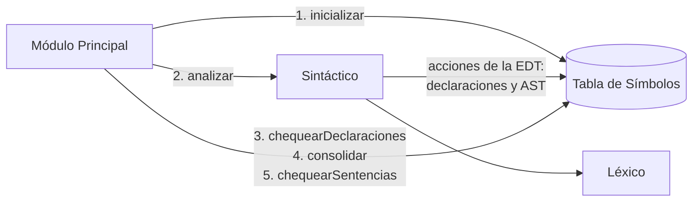
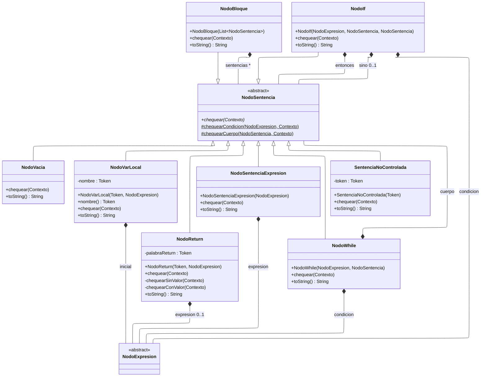
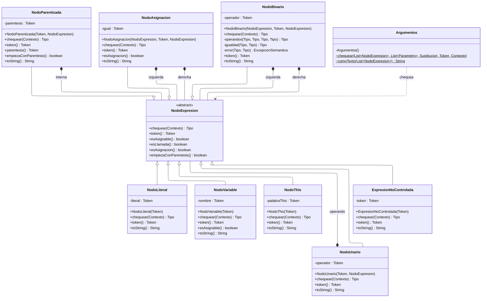
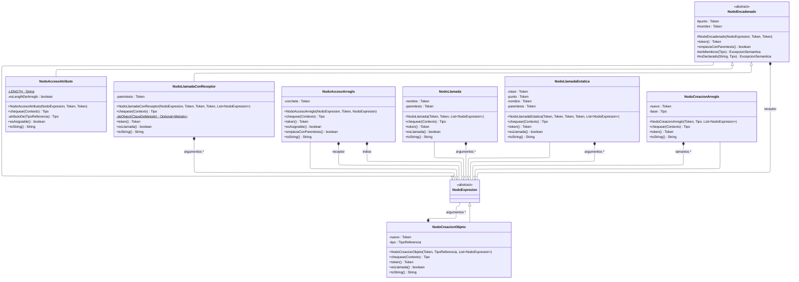
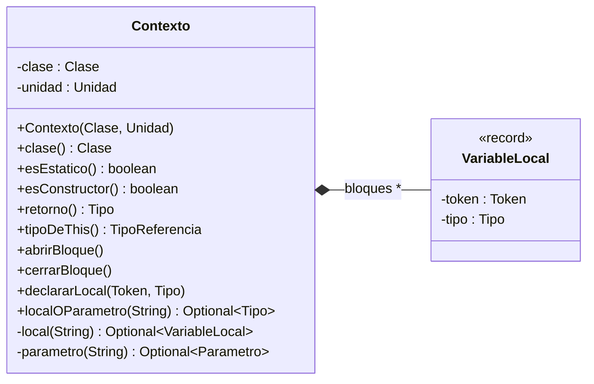

# Arquitectura del chequeo de sentencias

## Qué hace

La Etapa 4 completa la mitad del análisis semántico que la Etapa 3 dejó afuera: lo que está
**dentro** de los cuerpos de métodos y constructores (Clase 09, slides 2-4). Para eso el sintáctico
arma, mientras reconoce cada cuerpo, su **árbol sintáctico abstracto** (AST), y lo cuelga del método
o constructor de la tabla de símbolos (Pautas Etapa 4, slides 12-13 y 20). Cuando las declaraciones
están bien y la tabla está consolidada, se recorre cada AST: se resuelven los nombres y se chequean
los tipos y la forma de cada sentencia (Pautas, slide 7).

## El flujo de una compilación

Es el de la Clase 10, slide 50, y las Pautas Etapa 4, slides 15-27:

1. `ModuloPrincipalSemantico.conChequeoDeSentencias` inicializa la tabla con `Object`, `String` y
   `System`.
2. El sintáctico reconoce el programa. Sus acciones registran las declaraciones, como en la
   Etapa 3, y además arman el AST de cada cuerpo ([`esquema-de-traduccion.md`](esquema-de-traduccion.md)).
3. Si hubo un error léxico o sintáctico, se reporta como en la Etapa 2 y el semántico no corre.
4. Si no, la tabla chequea las declaraciones y consolida (Etapa 3). Un error ahí corta el análisis:
   las sentencias usan las entidades declaradas, así que tienen que estar bien (Clase 10, slide 50).
5. Recién entonces, `TablaDeSimbolos.chequearSentencias()` recorre cada clase, y cada clase chequea el
   cuerpo de sus constructores y de los métodos que **ella declara**. El primer error corta el análisis.

`--etapa=4` corre esta etapa, y es la etapa por defecto: los testers de la cátedra llaman al
compilador sólo con la ruta. `--etapa=3` corre el chequeo de declaraciones sin mirar los cuerpos.

## Un cuerpo se chequea una sola vez, en su clase

La herencia se implementa por copia: la consolidación pone los métodos heredados en la tabla de cada
descendiente (Clase 10, slide 51). Un cuerpo no se chequea en cada clase que lo hereda, sino sólo en la
que lo declara (documento §14). Para eso cada `Unidad` guarda su **`declarante`**, la clase o interfaz
que la declara. La copia que arma la consolidación conserva el mismo declarante y el mismo cuerpo, y
`Clase.chequearSentencias()` saltea los métodos cuyo declarante es otra clase. Así el cuerpo de
`Base<T>` se chequea con la `T` de `Base`, y no como si se hubiera escrito en cada descendiente
(documento §5.1).

## El diseño del AST

Los tipos de nodo salen de la **gramática original** de la cátedra (Clase 09, slides 35-40): cada
regla con significado es un nodo, y cada parte derecha que importa es un hijo. La gramática LL(1)
del parser no sirve de guía, porque está deformada por las necesidades del análisis: para quitar la
recursión a izquierda y factorizar se agregaron no terminales como `RestoExpresionCompuesta` o
`SentenciaDesdeIdClase`, que no significan nada. Esos no terminales no tienen nodo: arman el nodo de
la regla original con lo que les pasa su padre ([`esquema-de-traduccion.md`](esquema-de-traduccion.md)).

Cada nodo es una clase chica con dos responsabilidades: sus propios controles y delegar en sus hijos
(Pautas Etapa 4, slides 7-8; Clase 10, slides 25-28).

- Una **sentencia** se chequea y no tiene tipo: `void chequear(Contexto)`.
- Una **expresión** se chequea y devuelve su tipo: `Tipo chequear(Contexto)`.

La **información estructural** —si una expresión es un destino asignable, una llamada o una
asignación— la calcula cada nodo aparte, con `esAsignable()`, `esLlamada()` y `esAsignacion()`. Es la
Alternativa 1 de la Clase 11 (slides 29-32), la que la slide 32 llama «la más sencilla de
implementar y utilizar». La única información que depende de un tipo es si un acceso es el `length`
de un arreglo, que no es asignable: `NodoAccesoAtributo` la anota al chequearse
([`decisiones-de-diseno.md`](decisiones-de-diseno.md) §4).

Los diagramas siguen las convenciones de la Etapa 3
([`../semantico/arquitectura-del-analizador-semantico.md`](../semantico/arquitectura-del-analizador-semantico.md)):
UML con todos los campos, constructores y métodos; lo subrayado es estático y lo que está en cursiva,
abstracto; una referencia a otra clase del diagrama es una relación rotulada con el campo y su
multiplicidad (`0..1` si puede faltar, `*` si es una colección); una caja sin miembros se detalla en
otro diagrama. `herramientas/diagramas_de_clases.py` verifica que coincidan con el código y los
renderiza para el informe.

### Las sentencias

`NodoBloque` es el cuerpo de cada unidad. `sino` falta en un `if` sin `else`, y `expresion` falta en un
`return;`. `SentenciaNoControlada` representa el `for` y la declaración local con tipo, que son de
logros que no se persiguen ([`decisiones-de-logica.md`](decisiones-de-logica.md) §1).

<!-- diagrama: sentencias -->

### Las expresiones

`token()` es el token donde javac ubica un error de la expresión entera, por ejemplo una condición
que no es `boolean`: el operador de una binaria, el `(` de una llamada, el `.` de un acceso
([`decisiones-de-deteccion-de-errores.md`](decisiones-de-deteccion-de-errores.md)). `Argumentos`
chequea los argumentos de cualquier llamada contra los parámetros de la unidad elegida.

<!-- diagrama: expresiones -->

### Las llamadas, los accesos y las creaciones

Un encadenado guarda su **receptor**: `a.b[0].m()` es la llamada a `m` sobre el acceso a `[0]` sobre
el acceso a `b` sobre `a`. Así el último acceso es el nodo de afuera, que decide si la expresión
entera es asignable o una llamada (documento §11.5). Es más simple que la lista de encadenados de la
Clase 10, slide 31, que hace que cada eslabón reciba el tipo del anterior: acá cada nodo chequea su
receptor y obtiene ese tipo él mismo ([`decisiones-de-diseno.md`](decisiones-de-diseno.md) §3).

<!-- diagrama: llamadas-y-accesos -->

### El contexto del chequeo

`Contexto` es lo que necesita un nodo para resolver un nombre: la clase y la unidad actuales y las
variables locales visibles, en un mapa por bloque abierto (documento §2 y §12.6). Busca en el orden
del documento §10.1: una local visible, un parámetro de la unidad y, si no, el nodo busca un
atributo de la clase. `declararLocal` aplica las reglas del §12.3: una local no repite un parámetro
ni una local visible de un contenedor, y sí puede ocultar un atributo.

<!-- diagrama: contexto -->

## Los tipos

El chequeo usa los tipos de la Etapa 3
([`../semantico/arquitectura-del-analizador-semantico.md`](../semantico/arquitectura-del-analizador-semantico.md),
«Los tipos»), con tres agregados:

- **`conformaCon(Tipo destino)`**, la conformidad del documento §9. Un primitivo conforma sólo
  consigo mismo; `void`, con nada; `null`, con cualquier referencia, arreglo o parámetro de tipo; una
  referencia, con `Object` y con sus ancestros, recorridos con la sustitución de cada relación de
  herencia y con los argumentos invariantes; un arreglo, consigo mismo y con `Object`; un parámetro
  de tipo, sólo consigo mismo. Una herencia sin argumento se recorre con el parámetro que conserva:
  `class Derivada extends Base`, con `Base<T>`, conforma con `Base<T>`, con la `T` de `Base`
  (documento §5 y §9.3), y no con `Base<String>`.
- **`TipoNull`**, el tipo especial del literal `null`, que no se puede escribir (§3 y §9.5).
- **La identidad de un parámetro de tipo.** `VariableDeTipo` guarda el nombre de la clase o interfaz
  donde se escribió, y dos `T` son el mismo tipo sólo si los declara la misma clase (documento §5.1:
  «Para representar los tipos se debe conservar su declaración de origen, además del nombre»).
  `identidad()` es el nombre más esa declaración, y es lo que compara `esIgualA`.

Un miembro se ve **desde el receptor** (documento §5.1): con un receptor `Caja<String>`, el atributo
`T contenido` es `String`. Se reutiliza la `Sustitucion` de la consolidación, que reemplaza sólo la
`T` que declara el tipo del receptor: una `T` que se conservó de un ancestro por una herencia sin
argumento queda como está.
